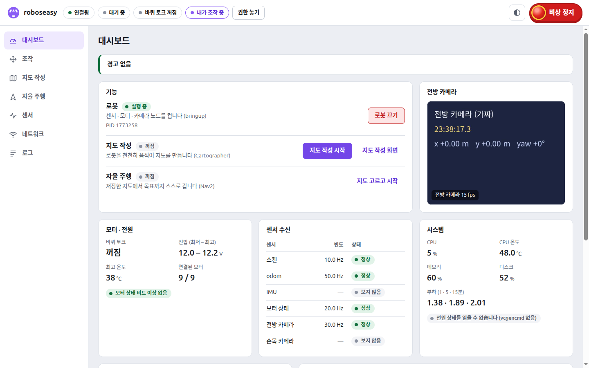
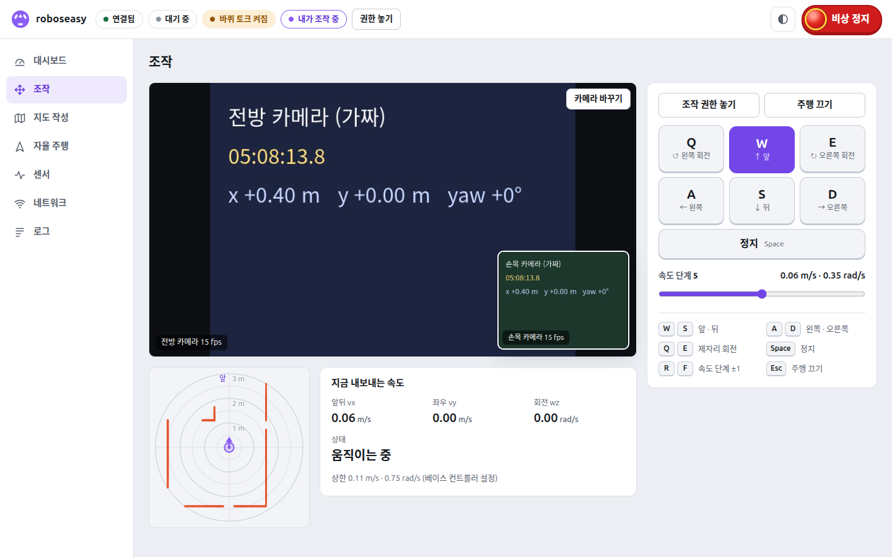
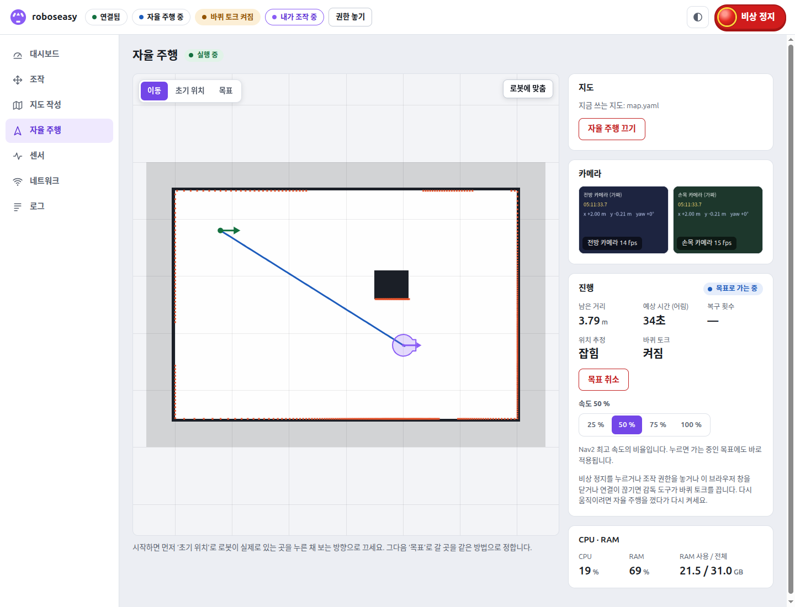

# LeKiwi 웹 오퍼레이터 사용 설명서

브라우저 하나로 LeKiwi를 보고 조작하는 운용 콘솔. 로봇 매니저처럼 대시보드 · 조작 · 지도 작성 · 자율 주행 · 센서 · 네트워크 · 로그 화면이 있다.

- 로봇(Raspberry Pi)에서 **게이트웨이 프로세스 하나**가 돈다. 화면 파일 · REST API · WebSocket을 모두 이것이 준다.
- 노트북 · 태블릿 · 휴대폰 브라우저로 `http://lekiwi01.local:8080`만 연다. **PC에 ROS가 필요 없다.**
- 기능(bringup · Cartographer · Nav2)은 지금과 같은 `ros2 launch`를 게이트웨이가 대신 켜고 끈다. 로봇 쪽 안전장치(베이스 컨트롤러의 0.3초 정지, Nav2 감독 도구)는 그대로 두고 그 위에 얹는다.
- 설치할 것이 없다: Pi의 시스템 Python과 ROS 2 Jazzy만 쓴다 (pip · 웹 프레임워크 · 인터넷 없이 동작).
- 대상: Ubuntu 24.04 · ROS 2 Jazzy LeKiwi (예: `lekiwi01`), 같은 네트워크의 최신 브라우저 (2026-10-19 Chrome으로 확인)



*2026-10-19 개발 PC에서 가짜 로봇으로 찍은 대시보드: 로봇(bringup) 실행 중, 센서 수신 정상 (IMU · 손목 카메라는 이 화면이 받지 않아 '보지 않음', 9장), 모터 9개 연결. 이름 `roboseasy`는 개발 PC 이름이다 (실물에서는 `lekiwi01`처럼 보인다)*

---

## 1. 무엇이 있나

| 화면 | 하는 일 |
|------|---------|
| 대시보드 | 경고, 기능 켜고 끄기 (로봇 · 지도 작성 · 자율 주행), 모터 · 전원, 센서 수신 빈도, 시스템 (CPU · 온도 · 전원 부족), 노드 상태, 전방 카메라 |
| 조작 | 전방 · 손목 카메라, 레이더 (로봇 둘레 3 m 스캔), 키보드 · 터치 조작 패드, 속도 단계, 지금 내보내는 속도 |
| 지도 작성 | Cartographer 켜기 · 끄기, 실시간 지도 + 스캔 + 로봇, 작은 조작 패드, 지도 저장, 자동 주행 맵 생성 (로봇이 스스로 돌아다니며 지도를 만들고 저장) |
| 자율 주행 | 저장 지도 고르기 (미리보기), Nav2 켜기 · 끄기, 지도 위에서 초기 위치 · 목표 정하기, 진행 (남은 거리 · 어림 예상 시간), 속도, 작은 전방 · 손목 카메라, CPU · RAM |
| 센서 | IMU (roll · pitch · yaw, 자이로, 가속도), odom (+ 원점으로), 모터 9개 표 |
| 네트워크 | IP · 와이파이 상태, 와이파이 검색 · 연결, AP 모드 켜기 · 끄기 · 이름 바꾸기 |
| 로그 | 웹에서 켠 기능의 실시간 출력 |

위쪽 바는 늘 보인다: 연결 상태 · 모드 · 바퀴 토크 · 조작 권한 · 밝기 바꾸기 · **비상 정지**. 폭이 900 px보다 좁으면 화면 고르기가 아래 탭바로 바뀐다.

[RViz 설명서](../README.md)에서 바뀌는 것:

| 예전 (RViz 설명서) | 웹 오퍼레이터 |
|------|------|
| 2-① `ssh`로 `ros2 launch lekiwi_bringup bringup.launch.py` | 대시보드 '로봇 켜기' |
| 2-②, ③ PC의 ROS 환경 · RViz | 필요 없다. 브라우저만 |
| 3장 RViz 화면, [`camera.md`](../camera.md) | 대시보드 (센서 빈도 · 노드 · 모터 · 전방 카메라), 조작 (카메라 두 대 · 레이더) |
| 6-3, 6-4 키보드 조작 (`ssh -X`, 터미널 두 개) | 조작 화면 (키보드 · 터치 패드) |
| 7장 Cartographer launch + `slam.rviz` + `save_map.sh` | 지도 작성 화면 |
| 8장 Nav2 launch + `nav2.rviz` (`2D Pose Estimate` · `Nav2 Goal`) | 자율 주행 화면 ('초기 위치' · '목표'). 감독 도구는 RViz 대신 이 게이트웨이의 조작 노드를 본다 |
| 로봇에서 `~/lekiwi_net/run_wifi.sh` · `run_ap.sh` | 네트워크 화면 |

그대로 RViz 설명서로 하는 것: 4장 스캔 방향 확인, 6장 노드 하나씩 실행, 거리 시험 · odom 보정 도구, TF · costmap을 자세히 볼 때.

---

## 2. 로봇에 설치

### ① 로봇에서 git clone

로봇(Raspberry Pi)에 SSH로 들어가 홈 폴더에서 저장소를 받는다.

```bash
ssh roboseasy@lekiwi01.local
git clone https://github.com/roboseasy/lekiwi_web_operator.git ~/lekiwi_web_operator
```

- 저장소 맨 위가 곧 `lekiwi_web_operator` 폴더다. **받는 위치는 꼭 `~/lekiwi_web_operator`.** ②의 실행 명령과 ③의 서비스 파일(`/home/roboseasy/lekiwi_web_operator`)이 이 경로로 정해져 있다.
- `clone` · `pull`을 할 때만 로봇이 인터넷에 닿아야 한다. 실행은 인터넷 없이 된다.
- 이미 `~/lekiwi_web_operator`가 있으면 (전에 복사해 둔 것) `clone`이 거절된다. 옮겨 두고 받는다: `mv ~/lekiwi_web_operator ~/lekiwi_web_operator.old`

로봇에 필요한 것: ROS 2 Jazzy, 빌드된 `~/lekiwi_ws` (`~/lekiwi_ws/install/setup.bash`). 따로 설치할 패키지는 없다.

### ② 바로 실행해 보기 (시험용)

```bash
ssh -t roboseasy@lekiwi01.local '~/lekiwi_web_operator/run_web_operator.sh'
```

`LeKiwi 웹 오퍼레이터 0.1.0 시작. 브라우저로 이 주소에 접속하세요:` 아래에 주소가 나온다. 끌 때는 `Ctrl+C` (정지 · 토크 끔 · 웹에서 켠 기능 끔).

- 기본값은 `ROS_DOMAIN_ID=42`, `ROS_AUTOMATIC_DISCOVERY_RANGE=SUBNET`이다. 스크립트가 정한다 (systemd는 `.bashrc`를 읽지 않는다).
- 서비스(③)가 이미 돌고 있으면 포트가 겹쳐 `주소를 열지 못했습니다`가 나온다. 먼저 `sudo systemctl stop lekiwi-web-operator`.
- 터미널을 닫거나 SSH가 끊기면 (SIGHUP) 게이트웨이가 `Ctrl+C`와 똑같이 정리하고 끝난다. 그러면 웹 화면도 끊긴다.
- `kill -9`나 오류로 게이트웨이가 죽으면 정리 없이 끝난다. 웹에서 켠 기능이 남고, 자율 주행 중이었으면 감독 도구가 조작 노드가 사라진 것을 약 20초 늦게 알아 그동안 Nav2가 목표로 계속 간다. 그래서 오래 켜 둘 때 · 자율 주행을 할 때는 ③(systemd)으로 돌린다 (게이트웨이가 죽으면 systemd가 남은 노드를 모두 SIGINT로 끈다).

### ③ 부팅할 때 자동 실행 (systemd, 처음 한 번)

```bash
ssh roboseasy@lekiwi01.local
sudo cp ~/lekiwi_web_operator/lekiwi-web-operator.service /etc/systemd/system/
sudo systemctl daemon-reload
sudo systemctl enable --now lekiwi-web-operator
```

- 서비스 사용자는 `roboseasy`, 경로는 `/home/roboseasy/lekiwi_web_operator`로 정해져 있다. 죽으면 3초 뒤 다시 켠다.
- 서비스는 시작할 때 `loginctl enable-linger roboseasy`를 켠다. 마지막 SSH를 끊으면 logind가 roboseasy의 공유 메모리(`/dev/shm`)를 지워 게이트웨이와 웹에서 켠 launch 사이의 ROS 통신이 멈추기 때문이다. 확인: `loginctl show-user roboseasy -p Linger` → `Linger=yes`
- 도메인이 42가 아닌 로봇이면 `sudo systemctl edit lekiwi-web-operator`로 `[Service]` 아래에 `Environment=ROS_DOMAIN_ID=<번호>`를 넣는다.

### ④ 다시 배포 · 상태 · 로그 · 멈추기

| 할 일 | 명령 |
|------|------|
| 다시 배포 (새 버전 받기) | 로봇: `cd ~/lekiwi_web_operator && git pull` → `sudo systemctl restart lekiwi-web-operator` (로봇에서 직접 고친 파일이 있으면 `git pull`이 거절된다: `git status`로 확인) |
| 유닛 파일이 바뀌었을 때 | ③의 `cp` · `daemon-reload` 뒤 `restart` |
| 상태 | `systemctl status lekiwi-web-operator` |
| 로그 | `journalctl -u lekiwi-web-operator -f` |
| 멈추기 (다음 부팅에 다시 켜짐) | `sudo systemctl stop lekiwi-web-operator` |
| 자동 실행 끄기 | `sudo systemctl disable --now lekiwi-web-operator` |

- 멈추거나 다시 켜면 **웹에서 켠 기능(로봇 · 지도 작성 · 자율 주행)도 꺼진다.** 터미널에서 켠 것은 그대로다. 다시 켠 뒤 '로봇 켜기'를 누른다.
- 멈출 때는 모든 노드가 SIGINT를 받는다 (`Ctrl+C`와 같다. 모터 드라이버가 스스로 속도 0 · 토크 끔을 한다). 다 꺼질 때까지 최대 90초.
- 저널의 `Request timed out` 줄은 30초 동안 놀던 연결을 닫은 것이라 괜찮다.

### 접속 주소

`http://<로봇 이름>.local:8080` 또는 `http://<IP>:8080` (예: `http://lekiwi01.local:8080`). 시작 로그와 대시보드 '로봇' 칸에 주소가 모두 나온다.

- **다른 이름은 일부러 거절한다** (`이 주소로는 열 수 없습니다. http://lekiwi01.local:8080 또는 IP 주소로 여세요`). 공격 사이트가 자기 도메인 이름을 로봇 IP로 바꿔 가리키면(DNS rebinding) 그 페이지가 같은 출처로 보여 로봇을 움직일 수 있기 때문이다.
- `*.local`은 인터넷 DNS가 줄 수 없는 이름이라 받는다 (SD 카드를 복제해 avahi가 바꾼 `lekiwi01-2.local`도 된다). 공유기 DNS 이름(`lekiwi01.lan` 등)은 거절된다.
- 다른 사이트에서 보낸 요청과 다른 페이지 안에 끼워 넣기(iframe)도 막는다. 연결은 IP 하나당 32개, 모두 256개까지 받는다.

---

## 3. 처음 쓰는 순서

⚠️ 바퀴가 움직인다. 주변에 사람 · 케이블이 없는지, **즉시 주 전원을 끌 사람이 옆에 있는지** 확인한다. 처음에는 바퀴를 띄운다.

### ① 조작 권한 받기

위쪽 바의 **'조작 권한 받기'**. '내가 조작 중'으로 바뀐다.

- 한 번에 한 화면만 조작한다. 다른 화면에는 '<IP> · <브라우저> 조작 중'으로 보이고, 그 화면은 보기만 한다.
- 다른 화면이 쥐고 있으면 `다른 화면(<IP> · <브라우저>)이 조작 중입니다`. 그 화면의 신호가 2초 넘게 끊겨야 넘겨받을 수 있다.
- 다 쓰면 '권한 놓기'. 정지하고, 이 권한으로 켠 토크를 끈다.

### ② 로봇 켜기

대시보드 → 기능 → 로봇 → **'로봇 켜기'** (`ros2 launch lekiwi_bringup bringup.launch.py`). 카메라가 필요 없으면 '카메라 포함'을 끈다.

- '켜는 중' → 핵심 노드가 보이면 '실행 중'. 센서 수신이 '정상'이 되는지 본다.
- 터미널에서 이미 켰으면 '외부 실행'으로 보인다. 그대로 써도 되고, 이 로봇에서 켠 것이면 웹에서 끌 수도 있다.
- 바퀴 토크는 꺼진 채 시작한다. 끌 때는 '로봇 끄기' → 확인 창 (지도 작성 · 자율 주행을 먼저 끈다).

### ③ 주행 (조작 화면)

'조작' 화면 → **'주행 켜기'** → 확인 창 (`바퀴가 움직입니다. 주변에 사람 · 케이블이 없고, 처음에는 바퀴를 띄웠는지 확인하세요.`) → '주행 켜기'. 위쪽 바가 '바퀴 토크 켜짐'이 된다.

| 키 | 동작 (누르고 있는 동안만, 함께 누르면 합쳐서) |
|---|---|
| `W` / `S` | 앞 / 뒤 |
| `A` / `D` | 왼쪽 / 오른쪽 옆걸음 |
| `Q` / `E` | 제자리 왼쪽 / 오른쪽 회전 |
| `Space` | 정지 |
| `R` / `F` | 속도 단계 한 칸 올림 / 내림 |
| `Esc` | 주행 끄기 (토크 끔) |

- 화면의 패드도 같다 (누르고 있는 동안, 여러 손가락 가능). 휴대폰 · 태블릿은 패드를 쓴다.
- 키는 한글 입력 상태에서도 된다. 입력 칸에 글자를 치는 동안에는 조작 키로 쓰지 않는다.
- 키를 모두 떼면 바로 멈춘다. 창 밖을 누르거나 다른 탭으로 가면 누르던 키를 모두 놓는다.
- 속도는 단계 5 (0.06 m/s · 0.35 rad/s)에서 시작한다. 베이스 컨트롤러 상한(`max_linear_*`, `max_angular_z`)을 넘는 단계는 고를 수 없다. 화면 아래에 지금 상한(베이스 컨트롤러 값)이 나온다.
- 패드마다 상한이 따로다 (베이스 상한과 둘 중 낮은 쪽, `config.PAD_LIMITS`, 2026-10-22 사용자 결정):
  - 조작 화면 패드 (`pad: 'drive'`): **0.23 m/s · 옆 0.23 m/s · 1.53 rad/s (88°/s)** (가장 큰 단계 22 = 0.23 m/s · 1.53 rad/s). 단계 20~22는 회전을 조금 더 빨리 올린다 (0.21 · 1.28, 0.22 · 1.41, 0.23 · 1.53)
  - 지도 작성 패드 (`pad: 'mapping'`, `pad`가 없는 teleop도): 전과 같은 **0.11 m/s · 옆 0.10 m/s · 0.75 rad/s** (가장 큰 단계 10 = 0.11 m/s · 0.64 rad/s)
  - 시작 단계는 둘 다 5 (0.06 m/s). 단계는 R/F로 바꾼다 (같은 단계표, 패드마다 위 상한까지)
  - 화면이 `pad`를 보내기 전 (조작 화면 3단계 작업 전)에는 조작 화면도 지도 작성 상한으로 돈다
- **처음에는 바퀴를 띄운 상태에서** `W` · `A` · `Q`가 [RViz 설명서 6-4장](../README.md#6-4-pi-터미널에서-키보드로-주행하기-lekiwi_terminal_teleop)의 표처럼 도는지 본다.
- 다 쓰면 '주행 끄기' (`Esc`) → '조작 권한 놓기'.



*2026-10-19 가짜 로봇으로 찍은 조작 화면: 주행을 켜고 `W`를 누르고 있는 중 (0.06 m/s). 위는 전방 · 손목 카메라(가짜 영상, '카메라 바꾸기'로 크고 작게 바꾼다), 왼쪽 아래는 레이더(로봇 둘레 3 m의 스캔, 위쪽이 로봇 앞)*

### ④ 비상 정지

위쪽 바 오른쪽의 빨간 **'비상 정지'**. 모든 화면에 있고, 확인 창 안에도 있다.

- **누구나** 누를 수 있다: 조작 권한이 없는 화면, 연결이 끊겨 다시 연결 중인 화면도.
- 손가락을 대는 순간 보낸다 (떼기를 기다리지 않는다). 두 길로 보낸다: 이미 열린 WebSocket과 `POST /api/estop` (WebSocket이 끊겼거나 다시 연결 중일 때 대신 간다). 연결 수가 꽉 차 새 연결이 막혀도 열린 WebSocket으로 간다. 알림은 하나만 뜬다.
- 하는 일: 속도 0, 자율 주행 목표 모두 취소 (RViz · 전에 켰던 게이트웨이가 보낸 목표도), 바퀴 토크 끔 (누가 켰든), 조작 노드를 내린다 (Nav2 감독 도구가 토크를 다시 켜지 못하게), 그다음 **팔 토크도 끈다** (`lekiwi/motor/arm_torque` false, 팔 원격 조작도 멈춘다). 알림: `비상 정지 (<누른 화면>): 멈춤 · 목표 취소 · 바퀴 · 팔 토크 끄는 중` (토크 끄기는 응답을 기다리지 않으므로 '끄는 중'이다)
- ⚠️ **팔 토크를 끄면 편 팔과 잡은 물건이 떨어진다** (사용자 결정: 비상 정지는 모든 토크를 끈다). 팔을 편 채 다룰 때는 팔 아래를 비운다. 팔을 놓지 않고 멈추려면 비상 정지 대신 '팔 멈춤'(⑥)을 쓴다.
- 팔 토크 끄기는 바퀴 토크 끄기 다음에 보내고 기다리지 않는다 (바퀴 정지를 늦추지 않는다). 결과는 `status.teleop_arm.estop`에 남고, 알림은:
  - 껐다: 이 게이트웨이가 켠 팔이었으면 파랑 `비상 정지: 팔 토크를 껐습니다` (아니면 알리지 않는다)
  - 드라이버가 일부 팔의 끄기를 확인하지 못했다: 빨강 `비상 정지: 팔 토크 끄기를 확인하지 못해 드라이버가 1초마다 다시 시도 중입니다 (<ID>)` · 응답이 없다: 빨강 `비상 정지: 팔 토크 끄기 응답이 3초 안에 없습니다`
  - 서비스가 없고 드라이버는 있다 (드라이버 팔 쓰기 꺼짐, `use_arm:=false`): 노랑 (이 게이트웨이가 켠 팔이면 빨강) `비상 정지: lekiwi/motor/arm_torque 서비스가 없어 팔 토크를 끄지 못했습니다 …`
  - 드라이버도 없다: 이 게이트웨이가 팔을 켠 뒤 끄기를 확인하지 못했으면 빨강 `비상 정지: 팔 토크를 끄지 못했습니다 (모터 드라이버 없음). 팔이 굳어 있으면 주 전원을 끄세요` (드라이버는 끝날 때 팔 토크를 그대로 둔다). 켠 적이 없으면 알리지 않는다
  - 어느 경우든 바퀴 정지는 그대로다. 이 게이트웨이가 켠 팔의 끄기가 확인될 때까지 `status.teleop_arm.is_torque_maybe_on`이 true다 (나중에 '팔 힘 빼기' 등으로 확인되면 남은 실패도 지운다).
- **걸린 채로 남는다.** 모든 화면 위에 빨간 띠가 뜬다: `비상 정지됨 (<누른 화면>). 다시 움직이려면 ‘주행 켜기’를 누르세요` (자율 주행 중이었으면 `… 자율 주행을 껐다가 다시 켜세요`).
- 풀기: 조작 권한을 가진 화면이 '주행 켜기' 또는 '자율 주행 시작'에 **성공**하면 풀린다. 권한을 놓았다 다시 받아도 풀리지 않는다.
- 누른 뒤 1초 안에 온 '주행 켜기' · '자율 주행 시작'은 거절한다 (`비상 정지 직후입니다. 잠시 뒤 다시 누르세요`). 이미 오고 있던 요청이 비상 정지를 이기지 않게 한다.
- 누르고 있던 키 · 패드는 모두 놓는다. 풀린 뒤에도 키를 새로 눌러야 움직인다.
- 누른 화면 이름은 조작 권한 표시와 같은 '<IP> · <브라우저>'다 (권한이 없는 화면 · 다시 연결 중인 화면도).
- 보기 전용 화면(8장)에서는 누를 수 없다.
- 네트워크로 보내는 정지다. 와이파이가 끊기면 닿지 않는다 (그때는 ⑤의 시간 제한이 멈춘다). 주 전원은 늘 손이 닿는 곳에 둔다.

### ⑤ 브라우저를 닫거나 연결이 끊기면

| 일 | 로봇 |
|------|------|
| 조작하던 탭을 닫음 · 새로 고침 | 연결이 끊기는 즉시 권한이 끝난다: 정지, 이 권한으로 켠 토크 끔, 조작 노드 삭제. 알림 `조작 화면 신호가 끊겨 로봇을 멈췄습니다 (<IP> · <브라우저>)` |
| 네트워크가 끊김 · 브라우저가 멈춤 | 생존 신호(0.5초마다)가 2초 끊기면 위와 같다. 그 전에도 조작 명령이 0.3초 끊기면 속도 0 (베이스 컨트롤러도 `cmd_vel`이 0.3초 끊기면 바퀴 0) |
| 다른 탭 · 창으로 감, 화면이 꺼짐 | 누르던 키 · 패드를 모두 놓고 0을 보낸다. 권한은 그대로 |
| 자율 주행 중에 위 일이 생김 | 조작 노드가 사라져 감독 도구가 토크를 끄고 끝난다. 다시 움직이려면 자율 주행을 껐다가 다시 켠다 |
| 팔 원격 조작 중에 위 일이 생김 | 리더 값을 더 보내지 않는다. **팔은 토크를 켠 채 그 자리를 유지한다** (떨어지지 않게). 알림 `팔 원격 조작을 멈췄습니다 (조작 권한이 끝남). 팔은 토크를 켠 채 그 자리를 유지합니다`. 팔 토크는 '팔 힘 빼기' 또는 비상 정지로 끈다 |
| 다시 연결됨 | 권한은 돌아오지 않는다. '조작 권한 받기'를 다시 누른다 |

조작하는 탭은 앞에 둔다. 몇 분 넘게 뒤에 숨겨 두면 브라우저가 타이머를 늦춰 권한이 끝날 수 있다 (안전하게 멈춘다).

### ⑥ 팔 원격 조작 (게이트웨이만. 2026-10-22 2a단계)

PC의 SO-101 리더암으로 르키위 팔을 움직이는 일의 게이트웨이 쪽이다 (기획: [`docs/teleop_dataset_plan.md`](docs/teleop_dataset_plan.md) 3-6 · 5장). **텔레오퍼레이션 화면과 PC 에이전트 · 리더 전송은 아직 없다** (2b · 3단계). 지금은 REST API와 `status.teleop_arm`만 있다.

| 명령 | 누가 | 하는 일 |
|------|------|------|
| 팔 시작 `POST /api/arm/start` | 권한 | 팔 토크를 켜고 (`lekiwi/motor/arm_torque` true, 이미 켜져 있으면 드라이버가 아무것도 쓰지 않는다) 팔 원격 조작 세션을 연다. 세션 중에만 리더 값이 `lekiwi/arm/goal`로 간다 |
| 팔 멈춤 `POST /api/arm/stop` | 권한 | 세션을 닫는다. **팔은 토크를 켠 채 그 자리를 유지한다** |
| 팔 힘 빼기 `POST /api/arm/relax` | 권한 | 세션을 닫고 팔 토크를 끈다 (편 팔은 떨어진다). 비상 정지 · 자율 주행 중에도 된다 |

- 팔 시작은 아래가 모두 맞을 때만 된다 (아니면 409와 이유, `status.teleop_arm.blocked_reason`과 같은 글):
  - 조작 권한이 있다, 비상 정지가 걸려 있지 않다 (걸려 있으면 먼저 '주행 켜기'로 푼다. 팔 시작으로는 풀리지 않는다), 누른 뒤 1초가 지났다
  - 자율 주행 · 자동 주행 맵 생성 중이 아니다
  - 팔로워 노드 `lekiwi_follower_arm_node`가 있다 (`팔 노드가 없습니다 (로봇 · 팔을 켜세요)`)
  - 드라이버가 팔 명령을 받는다: `lekiwi/motor/arm_ready` 발행자가 있다 (bringup `use_arm:=true`)
  - 팔로워 상태 `lekiwi/arm/status`가 1초 안에 왔다. 팔 시작이 `arm` 묶음을 스스로 구독하고 최대 2초 기다린다 (보는 화면이 없어도 된다: 2b의 PC 에이전트). 시작하는 동안과 세션 동안 구독을 유지한다
- 켜기는 비상 정지 번호를 본 그 잠금 안에서 ROS 큐에 넣는다. 그 뒤의 비상 정지가 보내는 끄기는 늘 이 켜기 뒤에 간다. 켜는 사이 비상 정지가 눌리면 늘 409로 끝내고 (그 비상 정지가 끈다. 한 번 더 끄고, 못 끄면 그 비상 정지의 실패로 적는다) `팔 원격 조작을 시작했습니다`를 알리지 않는다.
- 켜는 사이 '팔 멈춤' · '팔 힘 빼기' · 권한 끝 · 자율 주행 · 자동 주행이 있었으면 세션을 열지 않고 409로 끝낸다 (팔 토크는 그 길의 규칙대로: 팔 힘 빼기만 시작이 끝난 뒤 끈다).
- 세션은 그 조작 권한 하나에 묶인다. 권한 끝 (놓음 · 창 닫음 · 신호 2초 끊김 · 넘겨줌) · 팔 멈춤 · 팔 힘 빼기 · 비상 정지 · 팔로워 노드나 드라이버 팔 쓰기가 사라짐 (알림 `… (팔 노드가 사라짐) …`)이 세션을 닫는다. 비상 정지 · 팔 힘 빼기만 팔 토크를 끈다.
- '팔 힘 빼기'는 세션부터 닫고, 도는 팔 시작이 있으면 그것이 끝난 뒤에 끈다.
- **세션 중에는 자율 주행 · 자동 주행 맵 생성 시작을 거절한다** (`팔 원격 조작 중입니다. 먼저 ‘팔 멈춤’을 누르세요`). 팔을 편 채 로봇이 스스로 움직이지 않게, 사람이 팔 조작을 끝낸 뒤에 시작하게 한다 (자동 주행 맵 생성은 접은 팔 모양만 안다). 터미널에서 켠 자율 주행이 보이면 세션을 닫는다 (팔은 유지, 알림 `… (자율 주행이 켜짐) …`).
- 세션은 없지만 팔 토크가 켜져 있을 수 있으면 (이 게이트웨이가 켜고 끄기를 확인하지 못함 · `arm_ready` true) 자율 주행 · 자동 주행 맵 생성은 시작하고 노랑 알림 `팔 토크가 켜져 있습니다. 팔을 접었는지 확인하세요 (…)` (사용자 결정: 막지 않는다).
- 리더 값이 0.5초 넘게 오지 않으면 목표를 그치고 한 번 알린다 (`리더 값이 0.5초 넘게 오지 않아 팔 목표를 그쳤습니다 …`). 팔로워도 목표가 0.5초 끊기면 자세를 유지한다. 다시 오면 이어 보낸다 (팔로워가 차이가 크면 2초 램프로 맞춘다).

### ⑧ PC 에이전트 (리더암 프로그램, 게이트웨이 쪽)

PC에 USB로 꽂은 SO-101 리더암을 읽는 프로그램(PC 에이전트, 따로 만든다)이 `ws://<로봇>:8080/agent`로 붙는다. 규약은 [`docs/agent_protocol.md`](docs/agent_protocol.md) (v1)다. 화면(텔레오퍼레이션)은 다른 작업에서 만든다.

- **한 번에 하나.** 둘째 연결 · 보기 전용 게이트웨이는 `agent_rejected`를 받고 닫힌다. 붙은 뒤 2초 안에 맞는 `agent_hello`가 없거나, 그 뒤 읽을 수 있는 메시지가 2초 동안 하나도 없으면 닫는다 (에이전트는 0.5초마다 `heartbeat`. 바이트를 찔끔 보내는 것으로는 자리를 잡지 못한다). 메시지는 16 KiB까지.
- **허락**: 조작 권한을 가진 화면이 `POST /api/agent/approve` `{"agent_session": <status.agent.agent_session>}`를 불러야 리더 값을 쓴다 (화면이 본 연결 번호가 지금 연결과 다르면 409: 그사이 다른 PC · 이름을 흉내 낸 연결로 바뀐 것을 허락하지 않게) (`/api/agent/unapprove`로 거둔다). 허락은 그 조작 권한에 묶인다. 권한이 끝나면 (놓음 · 끊김 · 넘겨줌) 다음 메시지(0.5초 안)에 거두고 `agent_unapproved`를 보낸다. 다시 받아도 다시 허락해야 한다. 연결이 끊겨도 60초 안에 같은 `token`으로 다시 붙으면 허락이 이어진다.
- **리더 값**: 허락된 에이전트의 `leader` (`arm_*.pos` 6개, lerobot 단위)에서 `.pos`를 떼어 허락한 그 조작 권한이 그대로일 때만 3장 ⑥의 중계 (`relay_leader`)에 넘긴다. 팔 세션 ('팔 시작') 중에만 `lekiwi/arm/goal`로 가고, 0.5초 끊기면 그친다. 허락 전 · 세션 밖의 값은 버린다.
- 허락된 에이전트가 끊긴 채 5초 안에 돌아오지 않으면 팔 세션을 닫는다 (팔은 그 자리 유지, 알림 `… (PC 에이전트가 5초 넘게 끊김) …`). 돌아와도 사람이 '팔 시작'을 다시 눌러야 움직인다.
- 에이전트 때문에 나는 알림은 종류마다 1초에 한 번까지다. 리더암 상태 알림은 허락된 에이전트 것만 낸다.
- `agent_hello.version`은 1과 2를 받는다 (2는 보정 메시지를 더한다).
- **리더암 열고 닫기**: `POST /api/agent/leader_connect` `{port, calibration_id}` (에이전트가 알린 포트 · 보정 id 중 하나만) · `/api/agent/leader_disconnect`를 에이전트에 넘긴다.
- **검사 (신뢰 경계)**: 메시지는 16 KiB 이하 JSON 객체, 형 · 글 길이 (256) · 출력할 수 있는 글자 (줄바꿈 · 제어 문자는 거절, 이유 글은 빈칸으로 바꾼다) · 목록 길이 (32), token 비교는 `secrets.compare_digest`, `leader`는 6 관절이 정확히 유한한 수 (|값| ≤ 1000), `seq`가 늘어나는 것만, 약 65 Hz보다 촘촘하면 버린다. 잘못된 `agent_hello`는 거절하고 닫는다. 나머지 잘못된 메시지는 버리고 종류마다 서버 로그에 한 번 남긴다.
- 상태는 `status.agent` (11장).

### ⑦ 로봇을 끌 때 팔 (접은 뒤 토크 끔)

드라이버는 끝날 때 팔 토크를 그대로 둔다 (팔이 떨어지지 않게). 그대로 두면 드라이버 없이 굳은 팔이 남고, 그 뒤의 비상 정지로도 끌 수 없다. 그래서 **이 게이트웨이가 켠 팔 토크가 남아 있을 수 있으면** (`status.teleop_arm.is_torque_maybe_on`) 로봇(bringup)을 끄기 전에 팔을 접는다:

1. 세션을 닫는다.
2. 팔로워에 `lekiwi/arm/rest` (`std_srvs/Trigger`)를 부른다. 팔로워가 약 3초 동안 접은 자세로 간다 (`lekiwi/arm/status`가 `resting` → `rested`).
3. `rested`를 최대 6초 기다린다. 팔로워가 램프 뒤 1초에 못 온 관절과 함께 `rested`를 내면 (`warnings`: `접은 자세에 다 오지 못했습니다: <관절>`) 접은 것으로 보고 노랑 알림 `팔 접기: <경고>`.
4. `lekiwi/motor/arm_torque` false를 부르고 확인한다.
5. 그다음 로봇을 끈다 (지금까지와 같다).

| 어디서 | 못 접으면 (팔로워 거절 · 6초 안에 안 접힘 · 팔로워 없음 · 서비스 없음 · 토크 끄기 실패) |
|------|------|
| 웹의 '로봇 끄기' (`POST /api/process/stop` `{"name": "bringup"}`, 최대 약 12초 걸린다) | 모터 드라이버가 그래프에 없으면 (팔을 접거나 끌 길이 없다) 알리고 끈다 (노랑 `모터 드라이버가 없어 …`). 그 밖에는 **로봇을 끄지 않는다.** 409 `로봇을 끄지 않았습니다: <이유>. 팔을 손으로 받치고 force 로 팔 힘을 뺀 뒤 끌 수 있습니다` (빨강 알림도). `{"name": "bringup", "force": true}`면 접지 않고 팔 힘을 뺀 뒤 끈다 (노랑 `팔을 접지 않고 팔 힘을 뺀 뒤 로봇을 끕니다 (편 팔은 떨어집니다)`). 힘 빼기가 안 돼도 (서비스 없음 등) 끄고 알린다 (`팔 힘을 빼지 못했지만 로봇을 끕니다: …`). 두 번 눌러도 한 번만 접고, 접는 사이 권한이 끝났으면 끄지 않는다 |
| 게이트웨이를 끔 · 다시 켬 (SIGTERM · SIGHUP · SIGINT, 웹에서 켠 로봇) | 같은 순서를 최대 8초 안에 해 본다. **못 접으면 힘을 빼지 않는다** (지켜보는 사람 없이 팔을 떨어뜨리지 않게). 팔은 토크를 켠 채 남고, 서버 로그 · 알림 `게이트웨이 종료: 팔을 접지 못해 팔은 토크를 켠 채 둡니다: <이유>` |

- 진행은 알림 (`로봇을 끄기 전에 팔을 접습니다` → `팔을 접고 팔 토크를 껐습니다`)과 `status.teleop_arm.rest` (`idle` · `resting` · `rested` · `failed`, `reason`)로 보인다.
- 지도 작성 · 자율 주행이 켜져 있어 로봇 끄기가 어차피 거절될 때는 팔을 건드리지 않는다.
- **터미널에서 켠 bringup을 Ctrl+C로 끄는 것은 다루지 못한다** (게이트웨이를 거치지 않는다). 그때는 먼저 웹에서 '팔 힘 빼기'를 하거나 웹에서 로봇을 끈다.
- 이 게이트웨이를 켜기 전에 켜진 팔 토크 (전에 돌던 게이트웨이 · 다른 프로그램)는 모른다 (`is_torque_maybe_on`이 false다).

---

### ⑨ 보정 (팔로워 · 리더, 게이트웨이 쪽)

기획: [`docs/calibration_plan.md`](docs/calibration_plan.md). 화면은 `#/calibration` (다른 작업). 모든 명령은 조작 권한, 이름은 `[A-Za-z0-9_-]{1,40}`만.

| 팔로워 (로봇) | 하는 일 |
|------|------|
| 파일 목록 | 팔로워와 같은 폴더 (`LEKIWI_CALIBRATION_DIR` → 프로파일의 `calibration_dir` → `~/.cache/huggingface/lerobot/calibration/robots/lekiwi`)의 `*.json` (status 에는 32개까지)을 드라이버가 낸 `lekiwi/motor/arm_registers` (팔 1~6, lerobot `is_calibrated`와 같은 기준: homing_offset · range_min · range_max)와 맞춰 본다. 바퀴는 보지 않는다. 레지스터는 `calibration` 채널을 보는 동안만 받는다 |
| 고르기 `select {robot_id}` | 모터와 맞는 파일만 (레지스터를 모르면 503 `unavailable`: 로봇 기능을 켜야 한다, 읽을 수 없는 파일은 409). 게이트웨이 전용 `~/lekiwi_ws/arm_profile.yaml`의 `robot_id`를 바꾸고 (통째로 · 겹치지 않는 임시 파일 + fsync + 이름 바꾸기 · `robot_id: '<id>'`는 늘 작은따옴표, `rest_pose_ticks`도 늘 적는다: 없으면 `''` — rcl 은 빈 목록 `[]`을 버려 `robot_profile.yaml`의 tick 이 남는다) 켜져 있던 로봇 기능을 다시 켠다. 사람이 쓴 `robot_profile.yaml`은 읽기만 한다. 처음 쓸 때는 지금 값 (`robot_profile.yaml` · 팔로워가 알린 `robot_id` · `rest_pose_ticks`)에서 시작한다 |
| 모터 값으로 만들기 `from_motors {robot_id}` | 레지스터 (로봇 기능이 켜져 있어야 한다) + 바퀴 lerobot 기본값 (`drive_mode 0 · homing_offset 0 · 0~4095`)으로 새 파일. 있는 이름 · 다른 보정이 도는 중에는 거절 |
| 접은 자세 `rest_pose` | 지금 팔 tick (모터 상태 ID 1~6)을 `arm_profile.yaml`의 `rest_pose_ticks`로. 다음에 로봇 기능을 켤 때 팔로워가 읽는다 |
| 새로 보정 `start {robot_id}` → `middle` → `finish` (또는 `cancel`) | 새 이름만 (있는 이름은 409). 로봇 기능을 끄고 (모터 버스 주인이 없게) 보정 프로그램 `lekiwi_web_operator/follower_calibration_worker.py`를 `~/lerobot060_venv/bin/python`으로 켠다 (`pc_agent/lekiwi_pc_agent/calibration.py`, lerobot 0.6.0 순서, 포트는 TIOCEXCL 로 혼자 연다). 팔 토크가 켜진 모터가 있으면 아무것도 쓰지 않고 오류 (`팔 토크가 켜져 있습니다 (...)`). 끝나면 파일 · `arm_profile.yaml`의 `robot_id`를 쓰고 **접은 자세를 지운다** (가운데가 바뀌어 예전 tick 은 다른 자세다: 다시 `rest_pose`). 보정 프로그램이 꺼진 것을 본 뒤에만 로봇 기능을 다시 켠다 (취소 · 오류도). 그동안 로봇 기능 켜기는 거절한다 |
| 되돌리기 `restore` | 지난 새로 보정이 되돌리지 못하고 끝났을 때 (전원 · 죽음 · 답 없음, `restore_pending`) 남은 예전 보정 값을 모터에 쓴다 (로봇 기능을 끄고 보정 프로그램으로). 다음 `start`도 먼저 되돌린다 |

- 고르기 · 접은 자세 · 새로 보정 · 되돌리기는 팔 세션 · 팔 토크가 켜져 있을 수 있음 (`is_torque_maybe_on` · `arm_ready`) · 지도 작성 · 자율 주행 · 자동 주행 · 로봇 끄는 중 · 다른 보정 중에는 409. 막는 것을 보고 바쁨을 거는 것은 한 번에 한다 (두 요청이 같이 지나가지 않는다).
- **되돌리기 (보정 프로그램)**: 취소 · 오류 · 예외 (KeyboardInterrupt 도) · 표준 입력 닫힘 · SIGTERM 이면 제로-포지션 위치 시키기로 쓴 값을 예전 것으로 되돌린다. SIGINT 는 무시한다. 되돌리지 못하면 오류 `reason`에 적는다. 쓰기 전에 모터의 예전 보정을 `~/lekiwi_ws/arm_calibration_restore.json` (arm_profile 옆, fsync)에 남기고 되돌리거나 끝내면 지운다.
- **답 없음**: `middle` · `finish` · `cancel`에 보정 프로그램이 10초 (`FOLLOWER_WORKER_STEP_TIMEOUT`) 안에 답하지 않으면 (각 줄의 `ack`) 죽이고 `모터 보정이 반쯤 쓰였을 수 있습니다. ‘되돌리기’를 누르세요` 오류. 시작은 20초.
- 조작 권한이 끝나거나 비상 정지면 도는 새로 보정을 취소한다 (보정 프로그램이 뜨기 전이면 띄우지 않는다). 레지스터는 새로 보정 앞뒤로 잊는다 (드라이버가 다시 알릴 때까지 `is_match` null).
- 게이트웨이를 끄면 보정 프로그램에 취소를 보내고 끝나지 않으면 죽인다 (로봇 기능은 다시 켜지 않는다).
- 리더 (노트북, PC 에이전트 v2): `check` · `from_motors {calibration_id}` · `start {calibration_id}` · `middle` · `finish` · `cancel`을 에이전트에 넘기고 (`port`는 선택, 에이전트가 알린 포트만), 에이전트의 `calib_status` · `calibration_ids`를 `status.calibration.leader`로 보인다. v1 에이전트에는 409. 팔 원격 조작 세션 중에는 `check` · `from_motors` · `start`를 409로 거절한다 (리더 가운데가 바뀌면 따라가던 팔로워가 튄다).
- 범위를 재는 동안 (팔로워 · 리더) 화면 상태를 10 Hz로 보낸다. 시작 · 끝 · 취소 · 오류는 알림으로도 뜬다.

## 4. 지도 만들기

지도는 **Pi가 만들고 Pi에 저장**한다. ⚠️ 로봇을 직접 움직인다. 3장과 같은 현장 확인을 한다.

**①** 대시보드에서 로봇이 '실행 중'인지 본다. 자율 주행은 꺼져 있어야 한다 (둘은 함께 켜지 못한다).

**②** '지도 작성' 화면 → **'지도 작성 시작'** (`ros2 launch lekiwi_cartographer cartographer.launch.py`). '실행 중'이 되고 지도가 그려지기 시작한다. 처음 몇 초는 로봇을 가만히 둔다.

**③** 같은 화면의 작은 패드로 '주행 켜기' → 천천히 움직인다 (단계 5 = 0.06 m/s). **회전은 특히 천천히.** 한 바퀴 돌아 처음 자리로 오면 지도가 맞춰진다. 벽이 두 겹으로 그려지면 너무 빨랐던 것이다.

**④** **'지도 저장'** (`ros2 run lekiwi_cartographer save_map.sh`). `저장했습니다 map.yaml`이 나오면 끝이다. 이미 있으면 덮어쓰지 않고 `map_<날짜_시각>.yaml`로 저장한다. 파일은 로봇의 `~/maps/lekiwi/`에 생긴다.

**⑤** **'지도 작성 끄기'** → 확인 창 (`저장하지 않은 지도는 사라집니다`).

- 흰색은 빈 바닥, 검은색은 벽, 회색은 아직 못 본 곳이다 (RViz와 같다). 점은 지금 스캔이다.
- 지도 작성 · 자율 주행 중에는 센서 화면의 'odom 원점으로'를 쓸 수 없다 (위치가 튀어 지도가 깨진다).

### 자동 주행 맵 생성

로봇이 라이다로 장애물을 피하며 방을 스스로 돌아다니고, 지도가 거의 다 되면 멈춰서 저장한다. Nav2는 쓰지 않는다 (Pi에서 Cartographer와 함께 돌리면 CPU가 모자라다). 게이트웨이 안의 작은 탐색기가 아직 못 본 곳과 맞닿은 빈 곳(프런티어)을 골라 찾아가고, 조작 패드와 같은 길(0.3초 신선도 · 램프 · 속도 상한 · 조작 권한)로 천천히 보낸다 (0.05 m/s · 0.3 rad/s).

⚠️ 로봇이 스스로 움직인다. 라이다는 바닥에서 약 2.5 cm 높이의 한 면만 보고, 바퀴 쪽 세 방향은 보지 못한다. 시작 전에 방을 정리한다:

- 현관 · 베란다 · 계단처럼 바닥이 낮아지는 곳, 유리 · 거울 · 검은 가구는 막아 둔다 (라이다에 안 보인다).
- 소파 · 침대 · 책상 아래 틈, 앞으로 약 10 cm 튀어나온 팔(바닥에서 약 16~30 cm 높이, 라이다가 못 본다)에 걸릴 의자 · 책상 가장자리, 바닥의 케이블을 치운다.
- 팔은 접은(웅크린) 자세로 둔다. 다른 프로그램이 팔을 움직이지 않게 한다.
- 화면을 켠 채 비상 정지를 누를 수 있게 지켜본다. 휴대폰 화면이 꺼지면 생존 신호가 끊겨 2초 뒤 멈춘다 (3장 ⑤).

**①** 위 ①~②처럼 지도 작성을 켠다 ('실행 중', 지도가 보인다). 로봇은 벽 · 가구에서 50 cm 넘게 떨어진 넓은 곳에 둔다.

**②** 작은 패드로 **'주행 켜기'** (이 화면의 조작 권한으로 켠 토크여야 한다).

**③** '자동 주행 맵 생성' 칸 → **'자동 주행 맵 생성'** → 확인 창 → '자동 주행 시작'.

- 먼저 제자리에서 45° 넘게 돌며 바퀴 쪽 사각을 본다. 그래도 주변이 좁으면 시작하지 않는다.
- 그다음 프런티어를 하나씩 찾아간다. 앞으로만 간다 (옆 · 뒤는 바퀴 쪽 사각이다). 방향이 35° 넘게 틀어지면 제자리에서 돌고, 그보다 작으면 앞으로 가며 조금씩 돈다.
- 지도 위에 지금 목표(초록 고리)와 경로(파란 선)가 보인다. 로봇은 몸체 원 + 앞으로 튀어나온 팔 상자로 그린다 (자동 주행이 충돌을 판단하는 모양).
- 칸에 상태 · 걸린 시간 · 알아낸 넓이 (본 빈 바닥, m²) · 남은 프런티어 수가 나온다. 다른 화면으로 가도 계속되고, 위쪽 바에 '자동 주행 중'과 '자동 주행 멈춤' 버튼이 보인다.
- 스캔 0.3초 · 지도 위 위치 0.5초 · 지도 5초보다 오래된 값이면 멈춰서 기다린다 ('기다리는 중'). 5초 넘게 이어지면 끝낸다.

**④** 갈 프런티어가 남지 않으면 멈추고 **스스로 지도를 저장한다** ('지도 저장'과 같은 길, 같은 파일 이름 규칙). 남은 곳으로 가는 문 · 통로를 사람이 잠깐 막으면 끝내지 않고 서서 기다린다 (오래 서 있으면 지도에 들어 '갈 수 없는 곳'으로 끝난다). 15분이 지나도 멈추고 저장한다. 칸에 끝난 이유와 `저장한 지도 <파일>.yaml`이 나온다. 다른 이유로 멈추면 저장하지 않는다: 필요하면 '지도 저장'을 누른다.

**⑤** 지도를 확인하고 '지도 작성 끄기'.

| 멈추는 방법 | 로봇 |
|------|------|
| `Space` · 패드 '정지' · '자동 주행 멈춤' (이 칸 · 위쪽 바) | 자동 주행만 멈춘다. 토크는 켜진 채 (바로 직접 조작할 수 있다) |
| 키보드 `W` `A` `S` `D` `Q` `E` | 자동 주행을 멈추고 그 키는 버린다. 뗐다가 다시 누르면 직접 움직인다. 패드의 방향 버튼은 자동 주행 중에는 막혀 있다 |
| `Esc` ('주행 끄기') · 권한 놓기 · 비상 정지 | 멈추고 토크를 끈다 |
| 화면을 닫음 · 연결 끊김 · 생존 신호 2초 끊김 | 위와 같다 (3장 ⑤) |
| '지도 작성 끄기' | 자동 주행을 먼저 멈추고 끈다 |

로봇이 스스로 멈추는 때 (저장하지 않는다):

| 문구 | 뜻 · 할 일 |
|------|------|
| `무언가에 걸린 것 같아 멈췄습니다 …` | 보낸 만큼 움직이지 못했다 (3초 동안 앞으로 0.10 m를 보냈는데 0.03 m도 못 감, 또는 0.6 rad를 돌렸는데 0.15 rad도 못 돎). 몸체 · 팔 높이의 가구 아래 틈 · 문턱을 본다. 스스로 빠져나오지 않는다 |
| `막혀서 자동 주행을 멈췄습니다. 직접 조금 옮긴 뒤 다시 시작하세요` | 목표에 연달아 세 번 가지 못했다 |
| `센서가 끊겨 자동 주행을 멈췄습니다` | 스캔 · 지도 위 위치 · 지도가 5초 넘게 늦었다 |
| `주변이 좁아 시작할 수 없습니다 …` | 제자리에서 돌 자리가 없다. 넓은 곳으로 옮긴다. 라이다에 안 보이는 검은 · 유리 가구가 바로 앞(약 60 cm 안)에 있어도 그 앞을 몰라 이렇게 멈춘다 |
| `갈 수 있는 곳이 좁아 더 탐색하지 못했습니다 …` | 로봇 자리에서 닿는 바닥이 2 m²보다 좁다 (안쪽이 약 2.3 m × 2.3 m보다 작은 방, 둘레가 막힌 자리). 넓은 곳으로 옮긴다 |

- 약 0.95 m보다 좁은 문 · 틈은 지나가지 않는다 (어디서든 제자리에서 돌 자리를 남긴다). 그 너머는 직접 옮긴 뒤 다시 시작한다.

---

## 5. 자율 주행

Nav2도 **Pi에서** 돈다. ⚠️ 로봇이 스스로 움직인다. 처음에는 **1 m 안쪽 목표**만 준다.

**①** '자율 주행' 화면 → '지도' 목록에서 고른다. 새로 저장한 지도('마지막 저장')가 먼저 골라져 있고, 아래에 미리보기가 나온다.

**②** **'자율 주행 시작'** → 확인 창 → '자율 주행 시작'. 게이트웨이가 먼저 조작을 멈추고 웹에서 켠 토크를 끈 뒤 `ros2 launch lekiwi_navigation2 navigation.launch.py map:=<지도> operator_nodes:=lekiwi_web_operator_view`를 켠다. '실행 중'이 되면 ③으로 간다.

**③** 지도 위 도구 **'초기 위치'** → 로봇이 실제로 있는 곳을 **누른 채 로봇이 보는 방향으로 끌었다 놓는다** (RViz `2D Pose Estimate`와 같다). 스캔 점이 지도의 벽과 겹치면 맞은 것이다. 어긋나면 다시 한다. '위치 추정'이 '잡힘'이 된다.

**④** **'목표'** → 갈 곳을 같은 방법으로 정한다. 경로(파란 선)가 생기고 로봇이 따라간다. '진행'에 남은 거리 · 예상 시간 (어림)이 나오고, 도착하면 '도착'.

**⑤** 멈추기: '목표 취소' (토크는 켜진 채) · 비상 정지 · '자율 주행 끄기'. '목표 취소' · 비상 정지는 이 로봇의 Nav2 목표를 모두 취소한다 (RViz나 전에 켰던 게이트웨이가 보낸 목표도).



*2026-10-20 가짜 로봇으로 찍은 자율 주행 화면 (1440 × 1100 창): 웹에서 만든 지도로 Nav2(가짜)를 켜고 초기 위치 · 목표를 끌어 정한 뒤, 경로(파란 선)를 따라 목표(초록 화살표)로 가는 중. 벽 위의 점은 스캔이다. 오른쪽은 '지도' · 카메라 둘 · '진행' · 'CPU · RAM' (개발 PC 값)이다. 속도 칸은 찍을 때 게이트웨이에 속도 기능이 없어 브라우저에서 50 %를 넣어 보였다*

- 남은 거리 · 예상 시간은 게이트웨이가 어림한다. 남은 거리는 로봇에서 가장 가까운 경로 점까지의 거리에 그 점부터 경로 끝까지의 길이를 더한 값이고, 예상 시간은 남은 거리 ÷ (Nav2 앞으로 최고 속도 0.08 m/s × '속도' 비율)이다 (`config.NAV_MAX_LINEAR_SPEED` = `lekiwi_navigation2` `nav2_params.yaml`의 velocity_smoother `max_velocity` x. 베이스 컨트롤러 상한과 상관없다). 가속 · 회전 · 감속을 넣지 않아 보통 실제보다 짧다. Nav2 피드백(약 100 Hz)은 Pi CPU를 아끼려고 받지 않는다. 그래서 '복구 횟수'는 늘 '—'다.
- 바퀴 토크는 Nav2 감독 도구(`lekiwi_nav2_motor_guard`)가 켠다. 조작 권한이 살아 있고 비상 정지가 걸려 있지 않을 때만 켠다 ('바퀴 토크: 켜짐').
- 감독 도구는 한 번 토크를 끄면 다시 켜지 않는다: 비상 정지, 권한을 놓음, 창을 닫음 · 연결 끊김, 스캔 · odom 끊김, 1시간 지남 (launch 기본 `motor_guard_duration` 3600초). 감독 도구가 그래프에서 사라지면 바로 목표 · 초기 위치를 받지 않고, Nav2 노드가 남은 채 3초 넘게 안 보이면 `자율 주행 감독 도구가 끝나 바퀴 토크를 다시 켤 수 없습니다. 자율 주행을 끄고 다시 켜세요 (로그: navigation)`가 뜬다. '자율 주행 끄기' → '자율 주행 시작'. (터미널에서 `Ctrl+C`로 끄면 감독 도구가 Nav2 노드보다 조금 먼저 끝난다. 그때는 알리지 않는다.)
- 초기 위치를 정하기 전에는 로그 화면(자율 주행)에 `Please set the initial pose` 같은 빨간 줄이 반복된다. 정상이다 (RViz 설명서 8장 ③).
- 자율 주행 중에는 조작 패드가 막힌다 (`자율 주행 중에는 직접 조작할 수 없습니다`).
- Nav2는 로봇을 반지름 0.22 m 원으로 본다 (`nav2_params.yaml`의 `robot_radius`). 접은 팔 끝(중심에서 가장 먼 점 0.217 m)이 겨우 3 mm 안에 든다: 벽 · 가구에 바짝 붙는 목표는 피한다 (12장).
- 도구는 한 번 쓰면 '이동'으로 돌아간다 (목표를 실수로 또 보내지 않게). 휠 · 두 손가락으로 확대하고, 끌거나 오른쪽 · 가운데 버튼으로 옮긴다. '로봇에 맞춤'.
- 터미널에서 켠 Nav2 (RViz 설명서 8장)도 '외부 실행'으로 보이고 목표를 줄 수 있다. 그때 감독 도구가 보는 것은 PC의 RViz다.
- 오른쪽 칸은 '지도' → 전방 · 손목 카메라 (작게 나란히, 이름 · fps) → '진행' → 'CPU · RAM' 순이다 (폭이 1100 px보다 좁으면 지도 아래로 내려간다). 'CPU · RAM'은 로봇 컴퓨터의 CPU % (모든 코어 평균. 9장의 '한 코어 대비'와 다르다), RAM %, RAM 사용 / 전체 GB다. 사용은 전체 − available이라 RAM %와 맞고, GB는 `free -h` · `htop`처럼 2³⁰ 바이트다.
- 이 화면도 카메라 두 대를 받는다: 작게 보여도 프레임은 조작 화면과 같아서, 게이트웨이 CPU가 카메라 몫만큼 늘어난다 (9장).
- **'속도'** ('진행' 안): Nav2 최고 속도의 25 · 50 · 75 · 100 %를 고른다. 누르면 바로, 가는 중인 목표에도 적용된다 (조작 권한이 필요하다). '속도' 옆에 지금 값이 나온다 (다른 화면이 그 밖의 값을 정했어도). 게이트웨이가 이 값(`status.navigation.speed_percent`)을 주지 않으면 이 칸은 보이지 않는다 (보기 전용 화면도: 로봇 게이트웨이가 정한 값을 모른다).
  - 100 %는 lekiwi_ws `nav2_params.yaml`의 Nav2 최고 속도다: MPPI `vx_max` 0.1 m/s를 velocity smoother `max_velocity`가 0.08 m/s로 자른다 (그래서 100 %와 75 % (0.075 m/s)가 거의 같다). 더 빠르게 하려면 lekiwi_ws 쪽 값을 바꾼다.
  - 게이트웨이는 Nav2 `speed_limit` 토픽(`nav2_msgs/SpeedLimit`, 퍼센트)으로 보낸다. controller_server가 MPPI의 앞뒤 · 옆 · 회전 상한(`vx_max` · `vx_min` · `vy_max` · `wz_max`)에 함께 퍼센트 ÷ 100을 곱한다 (25 %면 앞으로 0.025 m/s). `cmd_vel`에는 손대지 않는다.
  - 제자리 회전도 함께 느려진다 (25 %면 0.0625 rad/s). Nav2 진행 검사(`progress_checker`: 30초 동안 0.15 m)는 회전을 움직임으로 치지 않아, 25 %에서 제자리로 약 107°보다 많이 돌아야 하는 목표는 '실패'로 끝날 수 있다 (계산값, 실물에서 재지 않았다). 그때는 50 % 이상으로 한다.
  - 복구 동작은 이 비율을 따르지 않는다: `speed_limit`은 controller_server(MPPI)만 받는다. 목표로 가다 막히면 Nav2 기본 행동 트리(`navigate_to_pose_w_replanning_and_recovery.xml`, lekiwi_ws가 바꾸지 않았다)가 behavior_server의 제자리 회전(`Spin`, 90°) · 뒤로 가기(`BackUp`, 0.3 m)를 부른다. 25 %여도 회전은 0.2~0.25 rad/s (`min_rotational_vel` · `max_rotational_vel`), 뒤로는 0.08 m/s (행동 트리의 0.15 m/s를 velocity smoother가 자른다)다.
  - 값은 게이트웨이가 기억한다 (켤 때 100 %). 자율 주행이 꺼져 있어도 고를 수 있고 켜지면 적용된다. 실행 중 · 외부 실행인 동안은 고를 때 바로, 목표를 보낼 때마다 그 직전에 보내고, 100 %보다 낮으면 1초마다 다시 보낸다: controller_server가 다시 켜지면 100 %로 시작하기 때문이다 (그때도 1초 안에 맞춘다). 100 %는 1초마다 보내지 않는다: 새 controller_server는 이미 100 %이고, 아무도 고르지 않은 100 %가 다른 게이트웨이나 전에 켰던 게이트웨이가 낮춘 값을 덮으면 안 된다. 터미널에서 켠 Nav2에도 보낸다.
  - 그래서 게이트웨이를 다시 켜면 (배포 · 서비스 재시작) 터미널에서 켠 Nav2는 마지막 값 그대로 가는데, 화면은 조작 권한을 가진 화면이 값을 고르거나 웹에서 목표를 보낼 때까지 100 %로 보인다 (실제가 화면보다 느린 쪽이다).

---

## 6. 와이파이 · AP 모드

로봇의 무선(`wlan0`)은 **NetworkManager**가 맡고, 로봇의 `~/lekiwi_net/` 스크립트(`run_wifi.sh` · `run_ap.sh` · `set_ap.sh`)로 두 모드를 바꾼다. 게이트웨이는 이 스크립트를 `sudo -n`으로 뒤에서 부른다. 유선(`eth0`)은 어느 모드에서나 그대로다. 설계는 [AP 모드 기획서](docs/ap_mode_spec.md), 로봇을 이 방식으로 옮기고 되돌리는 법은 [robot_net/README.md](robot_net/README.md).

| 모드 | 로봇 | 접속 | 인터넷 |
|------|------|------|------|
| **공유기 모드** | 공유기에 붙는다 (`home-wifi` 프로필) | `http://lekiwi01.local:8080` 또는 공유기가 준 주소 (고정 `192.168.0.2NN`) | 공유기 |
| **AP 모드** | 로봇이 와이파이를 만든다 (`lekiwi-ap` 프로필: 이름은 로봇 이름과 같게, WPA2, 2.4 GHz 채널 6) | 폰 · 노트북의 와이파이를 그 이름으로 옮기고 `http://192.168.4.1:8080` 또는 `http://lekiwi01.local:8080` | 없다 (폰이 "인터넷 없음"이라고 해도 연결을 유지한다) |

**부팅 규칙:** 평소는 **공유기 우선**이다. 부팅하면 공유기에 붙고, 안 보이거나 못 붙으면 AP로 뜬다. 'AP 모드 켜기'는 **AP 고정**이라 재부팅해도 AP다. **한번 AP가 되면 (폴백이든 고정이든) 공유기가 다시 켜져도 AP에 남는다:** 감시해서 되돌리지 않는다 (AP에 붙은 폰을 운전 중에 끊을 수 있어서다). '공유기 모드로 돌아가기'를 누르거나 ssh로 `run_wifi`를 한다.

로봇에 필요한 것: NetworkManager가 켜져 있고, `~/lekiwi_net/`에 `run_ap.sh` · `run_wifi.sh` · `set_ap.sh` · `nm_kf.py`가 있고, 비밀번호 없는 `sudo`(`sudo -n true`)가 되어야 한다. `iw`가 없으면 '와이파이 검색'이, 위 셋 중 하나라도 없으면 '연결' · AP 칸이 꺼지고 화면이 이유를 보여 준다 (`/api/info`의 `network_features`). 옛 netplan 세대 로봇은 `robot_net/provision_ap_mode.sh`로 한 번 옮긴다 (랜선으로, 백업과 3분 되돌림 타이머가 붙는다).

### 6-1 AP 모드 켜기 · 끄기

**①** 조작 권한을 받는다. **②** '네트워크' → 'AP 모드' 칸의 **'AP 모드 켜기'** (공유기 모드일 때) → 확인 창. 확인 창에 다시 접속할 주소(와이파이 이름 · `http://192.168.4.1:8080` · `http://lekiwi01.local:8080`)가 나온다. **③** 게이트웨이가 `sudo -n ~/lekiwi_net/run_ap.sh`를 뒤에서 실행한다. 스크립트가 끝날 때까지 기다리고 (보통 수십 초, 150초가 지나도 죽이지 않는다), 그동안 다른 전환 · 와이파이 검색은 '이미 네트워크를 바꾸고 있습니다'로 거절한다. 이 화면은 끊긴다. 끊긴 동안에도 칸 제목이 **'전환 중 — 와이파이 ‘이름’에 붙은 뒤 이 주소로'**와 주소를 보여 준다. 폰 · 노트북의 와이파이를 로봇 이름으로 옮기고 그 주소로 다시 연다.

AP 모드일 때 같은 칸에서 **'공유기 모드로 돌아가기'** → 확인 창에 저장된 공유기 이름 → `run_wifi.sh` (저장된 공유기). 공유기에 못 붙으면 스크립트가 AP로 돌아온다. **저장된 공유기가 없으면** (이미지로 막 구운 카드는 공유기 프로필이 없다) 이 버튼이 꺼지고 '저장된 공유기가 없어 공유기 모드로 돌아갈 수 없습니다. 공유기 이름과 비밀번호를 입력해 연결하세요'가 나온다: 6-3처럼 공유기를 처음 등록한다.

AP 칸에는 상태(`켜짐 · 이름 · 2.4 GHz 채널 6 · 접속 n대`)와 접속 주소가 나온다. 접속 기기 수는 `iw dev wlan0 station dump`에서 읽고, 못 읽으면 뺀다. 마지막 전환이 실패했으면 (스크립트의 종료 코드가 0이 아님) 그 칸에 빨간 줄 **'마지막 전환 실패 (시:분): …'**이 나온다. 내용은 스크립트의 마지막 `error:` 줄이다 (공유기 연결 실패는 '와이파이 바꾸기' 칸에 나온다).

### 6-2 AP 이름 · 비밀번호 바꾸기

'AP 모드' 칸의 **이름 · 새 비밀번호 → '저장'** → 확인 창 → `sudo -n ~/lekiwi_net/set_ap.sh <이름> <비밀번호>`. AP가 켜져 있으면 AP를 다시 켜서 이 화면이 끊기니 새 이름 · 비밀번호로 다시 붙는다. **비밀번호 칸은 쓰기 전용이다:** 지금 비밀번호는 보여 주지 않고, 보낸 뒤 칸을 비운다. 잊었으면 새로 정한다. 비밀번호는 **8자 이상이면 된다** (AP 비밀번호를 아는 사람은 누구나 이 화면으로 로봇을 조작할 수 있다). 끝나면 성공 · 실패와 상관없이 게이트웨이가 저장된 이름을 keyfile에서 다시 읽어 보여 준다.

### 6-3 공유기 바꾸기 · 처음 등록하기

**①** 조작 권한. **②** '와이파이 바꾸기' 칸의 **공유기 이름(SSID)**과 비밀번호를 넣는다. 공유기 모드에서는 **'와이파이 검색'** (`sudo -n iw dev wlan0 scan`, 최대 15초: SSID마다 가장 센 신호 하나씩, 센 순서)에서 고르면 이름이 채워지고, 직접 고쳐 넣어도 된다 (숨긴 망은 이름을 직접 넣는다). **AP 모드에서는 검색이 꺼진다** (AP가 켜진 동안의 `iw scan`은 붙은 기기를 흔든다): 이름을 직접 넣는다. 이미지로 막 구운 카드는 이렇게 공유기를 처음 등록한다. **③** **'연결'** → 확인 창. **④** `sudo -n ~/lekiwi_net/run_wifi.sh <SSID> <비밀번호>`: 새 공유기를 **DHCP로 저장**하고 붙는다 (고정 주소 `.204`가 풀린다: 다시 고정하려면 ssh로 `setip 4`). 못 붙으면 스크립트가 AP로 돌아오고, 화면에 '마지막 전환 실패 (시:분): …'가 나온다 (틀린 비밀번호도 저장은 됐으니 다시 연결해 고친다).

### 6-4 로봇이 움직일 수 있는 동안은 거절한다

전환은 이 화면을 끊는다. 자율 주행 중이면 사람이 비상 정지를 누를 수 없으므로, **바퀴 토크가 켜져 있거나 · 지도 작성 · 자율 주행 · 자동 맵 생성 중이거나 · 팔 원격 조작 세션 중이거나 · 팔 토크가 켜져 있을 수 있으면** AP 켜기 · 끄기 · 이름 저장 · 공유기 연결을 서버가 `conflict`(409)로 거절하고 이유를 화면에 보인다. 로봇 상태를 못 읽어도 거절한다. 판정은 서버 한 곳(`network_switch_block`)이 하고, 화면은 그 이유만 보여 준다.

받지 않는 값:

| 값 | 이유 |
|------|------|
| 이름 · 비밀번호 모두: 제어 문자 · 특수 공백 (줄바꿈 · 탭 · 줄 바꿈 없는 공백 · 전각 공백 · 폭 없는 공백 등) · 앞뒤 공백 (공백만인 이름 포함) | keyfile이 앞뒤 공백을 버리고, 폰에서 같은 글자를 치기 어렵다 |
| AP 이름 1~32 바이트 밖, `;` · `\` | keyfile 규칙 (`ssid=`는 `;`를 목록 구분자로 본다) |
| AP 비밀번호 8~63자 인쇄 가능한 ASCII 밖 | WPA2 규격 (한글 불가). 8자 이상이면 된다 |
| 공유기 SSID의 `;` | `ssid=`의 목록 구분자: `65;66;`은 바이트 목록으로 읽혀 다른 SSID(`AB`)로 붙는다 (libnm 1.46으로 확인) |
| 공유기 `"` · `\` | 아직 시험하지 않은 글자라 막아 둔다 |
| 공유기 SSID 1~32 바이트 밖, 비밀번호 8~63 바이트 밖 | WPA 규칙. 바이트로 센다 (한글은 한 글자 3 바이트) |
| 비밀번호 없는 와이파이 | 지원하지 않는다 (숨긴 망은 이름을 직접 넣으면 된다) |

화면은 서버(`credentials_problem` · `ap_credentials_problem`)와 같은 규칙 · 문구로 미리 보이고, 서버가 다시 본다.

- 와이파이로만 붙어 있으면 전환하는 순간 화면이 끊긴다. 랜선이 있으면 PC는 유선 주소로 계속 볼 수 있다.
- 비밀번호는 스크립트의 인자로 넘어가서, 스크립트가 도는 동안 `ps`에 보이고 sudo 기록(auth.log · journal)에 남는다. 게이트웨이 로그 · 화면의 실패 줄에는 `***`로 가린다.
- 전환하는 동안(최대 약 2분)에는 게이트웨이 서비스를 멈추거나 재시작하지 않는다 (12장).

---

## 7. 안전장치 한눈에

| 장치 | 기준 | 하는 일 |
|------|------|------|
| 조작 권한 (lease) | 한 번에 한 화면 | 권한을 가진 화면만 움직이고 · 토크를 켜고 · 기능을 켜고 끄고 · 와이파이를 바꾼다. 신호가 2초 끊긴 권한만 넘겨받을 수 있다 |
| 생존 신호 | 0.5초마다, **2초** 끊기면 회수 | 정지 · 이 권한으로 켠 토크 끔 · 조작 노드 삭제. WS가 끊기면 바로 |
| 명령 신선도 | **0.3초** | 조작 명령이 0.3초 끊기면 목표 속도 0 (화면은 0.1초마다 보낸다). 베이스 컨트롤러도 `cmd_vel`이 0.3초 끊기면 바퀴 0 |
| 속도 상한 | 베이스 컨트롤러 파라미터 + 패드 상한 | `max_linear_x` · `max_linear_y` · `max_linear_speed` · `max_angular_z`를 읽어 자른다. 못 읽으면 0.10 m/s · 0.58 rad/s. 패드의 단계는 그와 따로: 조작 화면 0.23 m/s · 1.53 rad/s 안 (단계 22까지), 지도 작성 (그리고 `pad`가 없는 입력) 0.11 m/s · 옆 0.10 · 0.75 rad/s 안 (단계 10까지) |
| PC 에이전트 (3장 ⑧) | 하나만 · 생존 신호 2초 · 권한 화면의 허락 | 허락된 에이전트의 리더 값만, 팔 세션 중에만 `lekiwi/arm/goal`로 간다. 허락은 그 조작 권한이 끝나면 끝난다. 모든 메시지를 크기 · 형 · 유한한 수 · 관절 이름 · 빈도로 검사한다 |
| 조작을 막는 것 | 글로 이유를 보여 준다 | 보기 전용 · 권한 없음 · 자율 주행 중 · 베이스 컨트롤러 없음 · 베이스가 둘 이상 (같은 도메인의 다른 로봇) · `cmd_vel`에 다른 발행자 (터미널 키보드 조작 등) |
| 비상 정지 걸림 (latch) | 직후 **1초**는 켜기 거절 | 정지 · 모든 Nav2 목표 취소 · 토크 끔 · 조작 노드 내림. 권한을 가진 화면이 '주행 켜기' · '자율 주행 시작'에 성공해야 풀린다 |
| 입력 걸림 | 0 입력 한 번 | 비상 정지 · 주행 끄기 · 자율 주행 시작 뒤에는 키를 모두 뗄 때까지 움직임 입력을 버린다 |
| 자동 주행 입력 (4장) | 조작 권한 하나 · 자동 주행마다 번호 하나 | 자동 주행도 조작 패드와 같은 `cmd_vel` 길이다 (0.3초 신선도 · 램프 · 상한, 새 퍼블리셔 없음). 정지 · 비상 정지 · 주행 끄기 · 권한 끝 · 지도 작성 끔 · 자율 주행 시작이 같은 잠금 안에서 자동 주행도 끝낸다. 자동 주행 중 0 입력은 무시하고, 0이 아닌 입력은 자동 주행을 끝낸 뒤 입력 걸림처럼 버린다 |
| 자동 주행 충돌 예측 | 1초 앞, 0.1초마다 | 몸체 원 0.19 m + 접은 팔 상자 (중심에서 앞 0.22 m · 좌우 0.10 m) + 여유 0.08 m가 그 명령으로 1초 동안 지나갈 자리에 스캔 점 · 최근 3초 동안 기억한 점 · 지도의 장애물 칸이 있으면 0을 보낸다. 앞으로만 간다. 제자리에서 돌 때는 반지름 약 0.32 m 원 전체를 본다 |
| 자동 주행 둘러보기 | 시작할 때 · 오래 기다린 뒤 | 앞으로 가기 전에 제자리에서 45° 넘게 돌아 바퀴 쪽 사각을 본다. 돌 자리가 없으면 시작하지 않는다 |
| 자동 주행 걸림 | 3초 | 보낸 만큼 움직이지 못하면 (4장 표) 0을 보내고 끝낸다. 스스로 빠져나오지 않는다 |
| 비상 정지 → 팔 | 바퀴 다음에, 기다리지 않고 | 팔 토크도 끈다 (편 팔은 떨어진다). 못 끄면 알리고 바퀴 정지는 그대로 둔다 (3장 ④) |
| 팔 원격 조작 세션 (3장 ⑥) | 조작 권한 하나에 묶임 | 시작은 팔로워 · 팔 쓰기 드라이버 · 신선한 팔로워 상태가 있고 비상 정지 · 자율 주행 · 자동 주행이 아닐 때만. 권한 끝 · 팔 멈춤은 팔 토크를 켠 채 유지한다. 세션 중 자율 주행 · 자동 주행 시작은 거절하고, 세션 없이 팔 토크가 켜져 있을 수 있으면 시작하되 알린다 |
| 로봇 끄기 전 팔 접기 (3장 ⑦) | 이 게이트웨이가 켠 팔 토크가 남아 있을 수 있을 때 | 접고 (`lekiwi/arm/rest` → `rested`, 6초) 팔 토크를 끈 뒤에만 로봇을 끈다. 못 접으면 끄지 않는다 (force면 힘을 빼고 끈다). 게이트웨이 종료는 8초 안에 해 보고, 못 접으면 팔을 그대로 둔다 |
| 리더 값 끊김 | 0.5초 | `lekiwi/arm/goal`을 그친다 (팔은 그 자리 유지). 0.5초보다 밀린 값은 보내지 않는다 |
| Nav2 감독 도구 ↔ 조작 노드 | `lekiwi_web_operator_view` | 감독 도구는 이 노드가 그래프에 있을 때만 토크를 켜고, 사라지면 끄고 끝난다. 게이트웨이는 권한이 살아 있고 비상 정지가 걸려 있지 않을 때만 이 노드를 둔다 |
| 자율 주행 중 `cmd_vel` | 게이트웨이는 손대지 않는다 | `cmd_vel`을 구독하지 않고, 자율 주행 중에는 퍼블리셔도 없다 (감독 도구는 발행자가 `collision_monitor` 하나, 구독자가 베이스 하나인지 0.5초마다 본다). '속도'는 Nav2 `speed_limit`으로만 보낸다 (5장) |
| 보기 전용 | `--read-only` | 퍼블리셔 · 서비스 클라이언트 (자율 주행 목표 포함) · 조작 노드를 아예 만들지 않는다. 비상 정지까지 모든 명령을 거절한다 |
| 게이트웨이 끄기 | SIGINT · SIGTERM · SIGHUP (터미널 · SSH 끊김) | 정지 · 이 게이트웨이가 켠 바퀴 토크 끔 · 웹에서 켠 로봇을 끄기 전에 팔을 접고 팔 토크 끔 (못 접으면 팔은 그대로, 3장 ⑦) · 목표 취소 · 웹에서 켠 기능 끔 (자율 주행 · 지도 작성 → 로봇 순서). `nohup`으로 띄웠으면 SIGHUP은 그대로 무시한다 |

---

## 8. 다른 PC에서 보기 전용으로 보기

로봇은 그대로 두고, PC에서 게이트웨이를 하나 더 `--read-only`로 띄워 그 PC의 브라우저로 본다. 보기 전용은 아무 명령도 보내지 않는다: 조작 · 기능 켜고 끄기 · 와이파이 · 비상 정지 버튼이 꺼져 있다.

**PC가 DDS로 로봇에 닿아야 한다**: 같은 서브넷, 같은 `ROS_DOMAIN_ID`(42), `ROS_AUTOMATIC_DISCOVERY_RANGE=SUBNET`. PC에서 `ros2 node list`에 로봇 노드가 보이면 된다 (RViz 설명서 2장과 같은 조건).

```bash
# (선택, 한 번) 모터 상태까지 보려면 lekiwi_msgs도 빌드한다. 없으면 모터 상태만 빠진다
cd ~/workspace/lekiwi-repo/lekiwi_ws
colcon build --symlink-install --packages-select lekiwi_description lekiwi_msgs

source ~/workspace/lekiwi-repo/lekiwi_ws/install/setup.bash
export ROS_DOMAIN_ID=42
export ROS_AUTOMATIC_DISCOVERY_RANGE=SUBNET
cd ~/lekiwi_web_operator   # 이 저장소를 받은 폴더 (2장 ①)
python3 -m lekiwi_web_operator --read-only --port 8081
```

브라우저로 `http://localhost:8081`을 연다.

- ROS 노드 이름은 `lekiwi_web_operator_viewer_<PC 이름>`이다 (로봇의 게이트웨이와 겹치지 않는다).
- 자율 주행의 진행(남은 거리 · 예상 시간)과 '속도'는 보이지 않는다 (보기 전용은 자율 주행 목표를 다루지 않고, 로봇 게이트웨이가 정한 속도를 모른다). 지도 · 경로 · 위치는 보인다.
- 카메라 화면을 열면 영상이 DDS로 와이파이를 건너온다. 와이파이가 약하면 카메라 화면은 닫아 둔다.
- 실물 도메인에서 PC에 **보기 전용이 아닌** 게이트웨이를 띄우지 않는다.

---

## 9. Pi CPU

rclpy는 메시지마다 CPU를 쓴다. 그래서 게이트웨이는 빈도가 높은 토픽을 **보는 화면이 있을 때만** 구독하고, 필요 없어지면 5초 뒤 푼다.

| 무엇 | 언제 구독하나 |
|------|------|
| 모터 준비 · 지도 · 경로 · `/tf_static` (라이다 TF) · 노드 그래프 (1 Hz) | 늘 |
| 스캔 (10 Hz) | 'scan' 채널: 대시보드 · 조작 · 지도 작성 · 자율 주행 화면 |
| odom (50 Hz) | 'odom' 채널: 대시보드 · 센서 화면 |
| 모터 상태 (30 Hz, 2026-10-22 lerobot 데이터셋 30 fps에 맞춰 20 Hz에서 올렸다) | 'motors' 채널: 대시보드 · 센서 화면 |
| 팔로워 상태 (30 Hz) · 팔 관절 (30 Hz) · `lekiwi/motor/arm_ready` | 'arm' 채널 (텔레오퍼레이션 화면, 3단계), 팔 시작 · 세션 · 로봇 끄기 전 팔 접기 동안 |
| IMU (`lekiwi/sensor/lpf_imu`, 100 Hz) | 'imu' 채널: 센서 화면만 (대시보드는 받지 않는다. 100 Hz 하나가 Pi 코어를 크게 쓴다) |
| 지도 위 로봇 위치 · 위치 추정: `tf2_echo map base_footprint` 자식 프로세스 (10 Hz) | 'map' 채널: 지도 작성 · 자율 주행 화면. 게이트웨이는 `/tf`를 구독하지 않는다 |
| 카메라 | 대시보드 (전방) · 조작 · 자율 주행 화면 (둘 다) |
| 자율 주행 목표: 액션 서비스 3개 (`send_goal` · `get_result` · `cancel_goal`) + 목표 상태 토픽. 피드백(약 100 Hz)은 받지 않는다 | Nav2 노드가 보인 뒤 |
| 프로세스 훑기 (psutil) | 웹이 켜지 않은 기능의 노드가 보일 때 · 켜기 · 끄기 요청 때 |
| 조작 타이머 | 권한을 가진 화면이 있으면 20 Hz, 없으면 2 Hz |

자동 주행 맵 생성 중에는 보는 화면과 상관없이 스캔 · odom · 지도 위 위치(tf2_echo)를 구독한다 (4장). 끝나면 위 규칙대로 5초 뒤 푼다.

구독하지 않는 토픽은 대시보드 센서 수신에 '보지 않음'으로 나온다. 고장이 아니다. IMU는 대시보드에서 늘 '보지 않음'이다 (살아 있는지는 노드 상태 표, 값은 센서 화면). 구독을 막 시작하면 빈도를 2초 동안 재므로 그동안 느린 값은 '늦음' 대신 '측정 중'으로 나온다.

아래 CPU 값은 모터 상태가 20 Hz일 때 잰 것이다 ('motors' 채널을 받는 대시보드 · 센서 화면은 지금 조금 더 쓴다. 다시 재지 않았다).

2026-10-19 개발 PC(i9-14900HX)에서 실물 빈도로 맞춘 가짜 로봇으로 잰 게이트웨이 CPU (한 코어 대비. 게이트웨이를 P 코어 3개에 묶고 30초씩 두 번 잰 평균, 전 · 뒤를 번갈아 쟀다). '전'은 이 CPU 작업(채널마다 구독 · tf2_echo · 액션 서비스 · 쓰지 않는 서비스와 QoS 이벤트 처리기 없앰) 전의 코드다. Pi 4 어림은 실물에서 한 번 잰 배수 ×5.3 (작업 전 조작 화면: Pi 58 %, 이 PC 10.8 %)을 곱한 값이다. 작업 뒤 실물에서 잰 값은 표 아래에 있다.

| 화면 (게이트웨이가 받는 것) | 전 | 뒤 | 뒤의 Pi 4 어림 |
|------|------:|------:|------:|
| 로봇을 켜고 화면 없음 | 1.5 % | 1.2 % | 약 6 % |
| 화면 하나 연결, 구독 채널 없음 (네트워크 화면) | 9.9 % | 1.6 % | 약 8 % |
| 대시보드 (전방 카메라 30 fps · 스캔 · odom · 모터 상태) | 10.4 % | 6.7 % | 약 35 % |
| 조작 화면 (스캔 · 카메라 둘) | 10.8 % | 4.2 % | 약 22 % |
| 조작 화면 + 조작 권한 (조작 타이머 20 Hz · 조작 노드) | 13.1 % | 5.1 % | 약 27 % |
| 센서 화면 (IMU 100 Hz · odom · 모터 상태) | 19.6 % | 10.6 % | 약 56 % |
| 지도 작성 화면 (지도 작성 중 주행) | 31.5 % | 3.6 % + tf2_echo 3.9 % | 약 19 % + 21 % |
| 자율 주행 화면 (목표 진행 중, 카메라 칸을 넣기 전) | 24.3 % | 3.5 % + tf2_echo 1.3 % | 약 19 % + 7 % |
| 자율 주행 화면 (목표 진행 중, 카메라 둘. 2026-10-20에 잼) | | 5.1 % + tf2_echo 1.2 % | 약 27 % + 6 % |

- '전'의 대시보드 · 센서 화면은 연결만 하면 받던 스캔 · odom · 모터 상태를 더한 값이라 받는 토픽이 '뒤'와 같다 (센서 화면은 '뒤'에 스캔이 빠졌다).
- tf2_echo는 게이트웨이 밖의 C++ 자식 프로세스로, `/tf`를 받는 만큼 쓴다: 지도 작성 중 Cartographer 약 250 Hz, 자율 주행 중 AMCL 20 Hz + odom 50 Hz. Pi에서도 같은 배수일지는 모른다.
- IMU (100 Hz) 하나가 지금도 약 5 %p (Pi 어림 약 27 %p)다. 그래서 대시보드는 IMU를 받지 않는다. 남은 비용은 대부분 rclpy executor가 메시지마다 쓰는 시간이다 (이 PC에서 메시지 하나에 약 0.3~0.5 ms).
- 실물 lekiwi01 (Pi 4, 2026-10-19): 보기 전용으로 화면 하나 연결, ROS 데이터 없음 (로봇 스택이 꺼져 있었다) → 한 코어의 약 7.5 %, 메모리 86 MB. 이 작업 전 조작 화면 하나 (스캔 · 카메라 둘 약 20 fps · odom · 모터 상태) → 한 코어의 약 58 % (그중 rclpy executor 스레드 하나가 약 53 %).

**실물 lekiwi01 (Pi 4) 실측, 2026-10-20, 이 작업 뒤** (한 코어 대비, 20초씩. 웹으로 bringup(카메라 포함) · 지도 작성만 켜고 바퀴 토크는 켜지 않았다. 자율 주행은 토크가 켜지므로 재지 않았다)

| 화면 | 게이트웨이 | 함께 잰 것 |
|------|------:|------|
| 대시보드 (전방 카메라 20 fps · 스캔 · odom · 모터 상태) | 32.0 % | |
| 조작 화면 (스캔 · 카메라 둘 약 20 / 16.5 fps) | 19.2 % | 작업 전 58 % |
| 센서 화면 (IMU 100 Hz · odom · 모터 상태) | 35.2 % | |
| 지도 작성 화면 (지도 · 스캔, 로봇은 멈춘 채) | 9.5 % | tf2_echo 10.2 %, cartographer_node 40.7 % |

- PC ×5.3 어림보다 가볍게 나왔다: 조작 약 22 → 19.2 %, 지도 작성 약 40 → 19.7 % (게이트웨이 + tf2_echo). Pi에서는 tf2_echo가 게이트웨이보다 무겁다 (`/tf` 약 250 Hz를 받는다). 아래 로봇 쪽 권고를 따르면 줄어든다.
- Pi에서 `tf2_echo map base_footprint -r 10`이 돌고, 지도 화면을 떠나면 5초 뒤 꺼지는 것도 확인했다.
- 가장 무거운 화면은 대시보드 · 센서다 (odom 50 Hz · 모터 상태 20 Hz · 카메라 · IMU 100 Hz). 자율 주행 중에는 자율 주행 화면을 열어 둔다.

**로봇 쪽 권고 (이 프로젝트는 바꾸지 않았다)**: `lekiwi_cartographer/config/lekiwi_2d.lua` · `lekiwi_2d_imu.lua`의 `pose_publish_period_sec = 5e-3` (map → odom TF 200 Hz)을 `0.02` (50 Hz)로 올리면 `/tf`가 초당 약 150개 줄어, TF를 듣는 모든 노드(지도 화면이 띄우는 tf2_echo, PC의 RViz 등)가 가벼워진다. 지도 작성 중 tf2_echo가 쓰는 CPU (이 PC 한 코어 약 4 %)는 대부분 이것 때문이다. 바꿀지는 lekiwi_ws 쪽에서 정한다.

---

## 10. 문제 해결

| 증상 · 문구 | 원인 · 조치 |
|------|------|
| `이 주소로는 열 수 없습니다 …` | `.local` · IP가 아닌 이름으로 열었다 (예: `lekiwi01.lan`). `http://lekiwi01.local:8080` 또는 IP로 연다 |
| 화면이 안 열림 | `systemctl status lekiwi-web-operator`, `journalctl -u lekiwi-web-operator -f`. 브라우저와 로봇이 같은 네트워크인지 |
| 위쪽 바 '연결 끊김 · 다시 연결 중' | 네트워크 · 게이트웨이가 끊겼다. 다시 붙으면 '조작 권한 받기'부터 |
| `먼저 조작 권한을 받으세요` | 위쪽 바 '조작 권한 받기' |
| `다른 화면(…)이 조작 중입니다` | 그 화면이 '권한 놓기'를 누르거나 닫힌 뒤(신호 2초 끊김) 받는다 |
| `베이스 컨트롤러가 없습니다. 먼저 로봇을 켜세요` | 대시보드 '로봇 켜기' |
| `다른 프로그램이 cmd_vel 을 보내고 있습니다: …` | 터미널의 키보드 조작 등을 끈다 |
| `베이스 컨트롤러가 둘 이상입니다. 같은 ROS_DOMAIN_ID 에 다른 로봇이 있습니다` | 두 로봇의 `ROS_DOMAIN_ID`를 다르게 한다. 그동안 주행 켜기를 거절한다 |
| `비상 정지 직후입니다. 잠시 뒤 다시 누르세요` | 1초 뒤 다시 누른다 |
| `자율 주행 감독 도구가 끝나 …` | '자율 주행 끄기' → '자율 주행 시작' |
| `lekiwi/motor/power 서비스가 없습니다. 먼저 로봇을 켜세요` (로봇은 켜져 있음) | 게이트웨이는 막 다시 켰을 때를 위해 서비스를 2초 찾는다. 그래도 없으면 베이스 컨트롤러가 서비스를 내지 못한다. 노드 표 · 로그(로봇)를 본다 |
| `같은 기능이 2개 떠 있습니다: 로봇 (bringup) …` | 같은 launch를 터미널에서 또 켰다. 하나를 끈다 (같은 노드가 둘이면 모터 드라이버가 실패한다) |
| 센서 '보지 않음' | 그 토픽을 보는 화면이 없어 구독하지 않는다. 정상 |
| 센서 '끊김' (로봇은 켜져 있음) | 노드는 있는데 1초 넘게 안 온다. 로그 화면 · 노드 표를 본다 |
| 센서 '측정 중' | 구독을 막 시작해 빈도를 2초 동안 재는 중이다. 곧 '정상' (2초 뒤에도 느리면 '늦음') |
| '외부 실행 · 터미널에서 켠 launch 가 남아 있지만 노드가 보이지 않습니다 …' | 터미널에서 `Ctrl+Z`로 멈췄거나 노드가 죽고 `ros2 launch`만 남았다 (2026-10-19 lekiwi01에서 실제로 있었다: bringup 둘 · Nav2 하나). 대시보드에서 끈 뒤 다시 켠다. 멈춘 launch는 SIGINT를 못 받아 SIGKILL까지 약 20초 걸린다. 게이트웨이를 켠 뒤 10초 안에 보인다 |
| '외부 실행 · 다른 컴퓨터에서 실행 중이라 끌 수 없습니다' | 다른 컴퓨터에서 켰거나, 강제로 끈 launch의 노드가 10~20초 남아 있다. 기다리거나 켠 곳에서 끈다 |
| 와이파이 · AP 칸 `… ~/lekiwi_net 스크립트 · NetworkManager · sudo …를 쓸 수 없습니다` 또는 `먼저 로봇을 NetworkManager 세대로 옮기세요` | 로봇이 아직 옛 netplan 세대이거나(`robot_net/provision_ap_mode.sh`로 옮긴다), `~/lekiwi_net`의 스크립트가 없거나, NetworkManager가 꺼져 있거나, 비밀번호 없는 sudo가 안 된다 |
| AP 모드를 눌렀더니 `… 바꿀 수 없습니다. 먼저 …` | 로봇이 움직일 수 있다 (바퀴 토크 · 지도 작성 · 자율 주행 · 자동 맵 생성 · 팔 세션 · 팔 토크). 이유 글대로 먼저 끈다 |
| AP에 붙었는데 화면이 안 열린다 | 폰이 "인터넷 없음"이라며 와이파이를 버렸다 (Android는 "연결 유지", iOS는 "인터넷 없이 사용"을 고르고 모바일 데이터를 끈다). 주소는 `http://192.168.4.1:8080`. 이름 주소(`.local`)는 Android에서 안 될 수 있다 |
| 저널의 `Request timed out` | 30초 놀던 연결을 닫은 것. 괜찮다 |

---

## 11. 구조

```text
브라우저 (노트북 · 태블릿 · 휴대폰)
  │  HTTP    : 화면 파일 · REST /api/...
  │  WS /ws  : status 4 Hz · event · scan · map · plan · log · 카메라 JPEG
  │  WS /agent : PC 에이전트 (리더암) 하나 (docs/agent_protocol.md)
  ▼
게이트웨이  python3 -m lekiwi_web_operator   (로봇 Pi, 프로세스 하나, 포트 8080)
  ├─ HTTP 스레드 (연결마다)      Host · Origin · client id 검사 → 로봇 명령
  ├─ hub (브라우저마다 송신 스레드)  채널마다 최신 것만 보낸다
  ├─ ROS 스레드 (rclpy executor)  구독 · 발행 · 서비스 (자율 주행 목표도), 조작 타이머 20 Hz · 그래프 감시 1 Hz · 자율 주행 속도 1 Hz
  │    (rclpy 객체는 이 스레드에서만 다룬다. 다른 스레드는 큐로 일을 넘긴다)
  ├─ 자동 주행 스레드 (자동 주행 중에만)  최신 스캔 · 지도 · 자세를 읽어 계획 · 충돌 예측, 목표 속도를 조작 감독에 준다
  ├─ 프로세스 감시 스레드         웹에서 켠 launch의 로그 · 터미널에서 켠 launch 찾기
  └─ tf2_echo 자식 프로세스 + 읽기 스레드   'map' 채널이 있을 때만: map → base_footprint 10 Hz
  │
  ▼  ROS 2 (ROS_DOMAIN_ID 42)
ros2 launch: bringup · Cartographer · Nav2 (+ lekiwi_nav2_motor_guard)
```

| 파일 | 하는 일 |
|------|------|
| `run_web_operator.sh` | 로봇에서 실행 (ROS · lekiwi_ws source, 도메인 42 · SUBNET 기본) |
| `deploy_to_robot.sh` | 개발용: push 없이 PC → 로봇 `~/lekiwi_web_operator/` rsync 복사 (기본 설치는 `git clone`, 2장 ①) |
| `lekiwi-web-operator.service` | systemd 유닛 |
| `lekiwi_web_operator/__main__.py` | 조립 · 신호 처리 · 접속 주소 출력 |
| `http_server.py` · `websocket.py` · `hub.py` | HTTP · REST · WebSocket, 화면 세션 · 채널 |
| `agent.py` | PC 에이전트 `/agent`: 하나만 · 허락 · 리더 값 검사와 중계 (docs/agent_protocol.md) |
| `robot.py` · `teleop.py` | 안전 규칙 (조작 권한 · 생존 신호 · 비상 정지 · 자율 주행 시작 순서) |
| `ros_node.py` | rclpy 노드 (구독 · 라이다 TF · 서비스 · 자율 주행 목표 · 그래프 감시) |
| `explore.py` | 자동 주행 맵 생성 (ROS 없는 순수 로직): 계획 격자 · 프런티어 · 경로 · 따라가기 · 충돌 예측 |
| `tf_echo.py` | 지도 위 로봇 자세: tf2_echo 자식 프로세스를 띄우고 출력을 읽고, 끝나면 다시 띄운다 |
| `processes.py` | launch 켜기 · 끄기 (SIGINT → SIGTERM → SIGKILL) · 로그 · 외부 실행 찾기 |
| `network.py` · `system_info.py` · `map_files.py` · `map_codec.py` | 와이파이 · 시스템 · 지도 목록 · 지도 PNG |
| `config.py` · `robot_api.py` | 이름 · 시간 · 명령줄, 웹 ↔ 로봇 경계 |
| `web/` | 화면 (빌드 없는 HTML · CSS · JS 모듈, 외부 CDN · 글꼴 없음) |

### WebSocket 메시지 (`/ws`, JSON 텍스트)

| 방향 | type | 내용 | 언제 |
|------|------|------|------|
| 화면 → 서버 | `subscribe` | `channels: [...]` | 화면을 바꿀 때 (구독을 통째로 바꾼다) |
| 화면 → 서버 | `heartbeat` | | 0.5초마다 (모든 화면) |
| 화면 → 서버 | `teleop` | `x`, `y`, `yaw` (-1..1), `level`, `pad` (`drive` · `mapping`, 없으면 `mapping`) | 조작 · 지도 작성 화면에서 권한이 있으면 0.1초마다 (0 포함). 모르는 `pad`는 버린다 |
| 화면 → 서버 | `estop` | | 비상 정지를 누를 때 (`POST /api/estop`도 함께 보낸다. 보기 전용은 거절) |
| 서버 → 화면 | `welcome` | `client_id`, `info`, `you.ip` | 연결 직후 |
| 서버 → 화면 | `status` | 상태 전부 (+ `system` · `network`) | 0.25초마다 |
| 서버 → 화면 | `event` | `level` (info · warn · error), `message`, `time` | 상태가 바뀔 때 (모든 화면) |
| 서버 → 화면 | `scan` | `points` (base_footprint), `pose` (받았을 때 아는 자세 `odom` · `map`. 그 채널을 아무도 구독하지 않으면 null) | 'scan' 구독, 최대 5 Hz |
| 서버 → 화면 | `map` | `info`, `png` (base64) | 'map' 구독, 최대 1 Hz |
| 서버 → 화면 | `plan` | `points` (최대 300점) | 'plan' 구독, 최대 2 Hz |
| 서버 → 화면 | `log` | `process`, `lines`, `is_backlog` | 'logs/…' 구독 (처음에 200줄) |
| 서버 → 화면 | (바이너리) | 첫 바이트 `0x01` 전방 · `0x02` 손목, 나머지 JPEG | 'camera/…' 구독, 최대 15 fps |

| 채널 | 구독하는 화면 | 로봇 쪽에서 더 켜는 구독 |
|------|------|------|
| `scan` | 대시보드 · 조작 · 지도 작성 · 자율 주행 | 스캔 |
| `odom` | 대시보드 · 센서 (메시지는 따로 없고 `status.odom` · `pose.odom`을 채운다) | odom |
| `arm` | (텔레오퍼레이션 화면, 3단계) 메시지는 따로 없고 `status.teleop_arm`의 `arm_ready` · `follower` · `joints`를 채운다. 팔 시작 · 세션 · 팔 접기 동안은 보는 화면이 없어도 구독한다 | 팔로워 상태 `lekiwi/arm/status` (30 Hz) · 관절 `lekiwi/arm/state` (30 Hz) · `lekiwi/motor/arm_ready` |
| `motors` | 대시보드 · 센서 (`status.motors` · `power`를 채운다) | 모터 상태 |
| `imu` | 센서 (`status.imu`를 채운다) | IMU |
| `map` | 지도 작성 · 자율 주행 | `tf2_echo` 자식 프로세스 (`pose.map` · 위치 추정) |
| `plan` | 자율 주행 | |
| `camera/front` · `camera/wrist` | 대시보드 (전방) · 조작 · 자율 주행 (둘 다) | 그 카메라 |
| `logs/bringup` · `logs/mapping` · `logs/navigation` · `logs/save_map` | 로그 | |

어느 화면도 구독하지 않는 채널은 `status`의 그 값이 비어 있다: `odom` · `imu` · `power` · `pose.map`은 null, `motors`는 빈 목록, `rates` · `ages`도 null (대시보드 '보지 않음', 끊김 경고도 없다). 지도 · 경로 · 모터 준비는 늘 받는다.

`status.navigation`: `state` (`unavailable` · `idle` · `active` · `succeeded` · `aborted` · `canceled` · `rejected`), `goal`, `distance_remaining` [m] · `eta` [s] (게이트웨이 어림, 5장), `recoveries` (늘 null), `message`, `is_localized` (지도 위 위치가 1초 안에 왔는지), `speed_percent` (자율 주행 속도 [%] 정수, 5장. 자율 주행을 쓸 수 없거나 보기 전용이면 null).

`status.teleop`에는 `pad` (마지막 입력의 패드)와 `pads` (`drive` · `mapping`마다 `max_level` · `levels` · `max_linear_y`)가 있다. `max_level` · `levels`는 지도 작성 패드 것이다 (전과 같다).

`status.agent` (PC 에이전트, 3장 ⑧): `is_connected`, `agent_session` (이 연결의 번호, 허락에 돌려준다), `host`, `address`, `is_approved`, `ports` (`[{path, by_id}]`), `calibration_ids`, `leader` (`state` `disconnected` · `connecting` · `connected` · `error`, `port`, `calibration_id`, `reason`, `rate_hz` 최근 2초의 리더 값 빈도, `age` 마지막 리더 값 뒤 [s]). 붙어 있지 않으면 `is_connected` false · 나머지는 비어 있다.

`status.calibration` (보정, 3장 ⑨):
- `follower`: `robot_id` (팔로워가 알린 것, 모르면 프로파일 값), `is_match` (그 파일이 모터와 맞는지, 모르면 null), `reason`, `files` (`[{id, is_match, modified}]`, is_match는 레지스터를 모르면 null), `motors` (`{ids, homing_offset, min, max}` 레지스터, 모르면 null), `rest_pose_ticks` (ID 1~6, 프로파일 값, 없으면 null), `restore_pending` (되돌릴 예전 보정 값이 남아 있다: `reason`이 ‘되돌리기’를 알린다), `session` (`{state: idle · starting · waiting_middle · recording · saving · done · error · cancelled, robot_id, joints: {모터: {now, min, max}}, reason}`)
- `leader`: `files` (`[{id, is_match}]`, `calib_check` 전에는 is_match가 null), `session` (`{state, calibration_id, joints, reason}`, 에이전트 `calib_status`)

`status.teleop_arm` (팔 원격 조작, 3장 ⑥): `is_follower_present` (그래프에 `lekiwi_follower_arm_node`), `arm_ready` (`lekiwi/motor/arm_ready`, 모르면 null), `follower` (`lekiwi/arm/status`의 `state` `idle` · `ramping` · `following` · `error`, `reason`, `robot_id`, `diffs`, `ramp_progress`, `warnings`. 2초 안에 온 것만), `follower_age` [s], `joints` (`lekiwi/arm/state` 관절 → LeRobot 단위), `is_session_active`, `blocked_reason` (팔 시작을 막는 이유, 되면 null), `leader` (`is_relaying` 지금 `lekiwi/arm/goal`을 보내는지, `age` 마지막 리더 값 뒤 [s]. PC 에이전트 연결 · 주기는 2b에서 더한다), `estop` (마지막 비상 정지의 팔 토크 끄기: `state` `pending` · `ok` · `failed` · `unavailable`, `message`, `time`), `is_torque_maybe_on` (이 게이트웨이가 켠 팔 토크의 끄기를 아직 확인하지 못했다), `rest` (로봇 끄기 전 팔 접기, 3장 ⑦: `state` `idle` · `resting` · `rested` · `failed`, `reason` 실패 이유 · `rested`의 팔로워 경고, `time`). `arm_ready` · `follower` · `joints`는 `arm` 묶음을 구독하는 동안만 있다. `follower.state`에는 `resting` · `rested`도 온다.

`status.exploration` (자동 주행 맵 생성, 4장): `state` (`idle` · `starting` 둘러보기 · `exploring` · `waiting` 센서를 기다림 · `saving` 자동 저장 · `done` · `stopped`), `reason` (끝난 · 기다리는 이유), `started_at` · `elapsed` [s], `explored_area` [m²] (본 빈 바닥), `frontiers` (남은 프런티어 수), `target` `{x, y}` · `path` `[x0, y0, …]` (map 프레임, 최대 200점), `saved_map` (자동 저장한 지도 파일).

### REST API

모든 요청은 Host가 허용 목록 안이어야 한다 (2장 접속 주소). POST는 `Content-Type: application/json`, 같은 출처의 `Origin`, 연결된 화면의 `X-Client-Id` (WS `welcome`의 `client_id`, 비상 정지만 없어도 된다), 64 KiB 이하 JSON 객체여야 한다. 답은 `{"ok", "code", "message"}`이고 code가 HTTP 상태가 된다: `ok` 200 · `bad_request` 400 · `not_operator` · `read_only` 403 · `conflict` 409 · `failed` 500 · `unavailable` 503.

| 메서드 · 경로 | 본문 | 누가 | 하는 일 |
|------|------|------|------|
| GET `/api/info` | | 누구나 | 로봇 이름 · 버전 · 보기 전용 · 기능 · 속도 단계 · 접속 주소 |
| GET `/api/status` | | 누구나 | 상태 (WS `status`와 같다) |
| GET `/api/maps` | | 누구나 | 저장 지도 목록 · 지도 폴더 |
| GET `/api/maps/preview?name=<파일>.yaml` | | 누구나 | 지도 미리보기 PNG |
| GET `/api/logs?process=<기능>&lines=200` | | 누구나 | 최근 로그 (최대 500줄) |
| GET `/api/network` | | 누구나 | 인터페이스 · IP · 와이파이 · 모드 (AP · 공유기) · 저장된 AP · 공유기 이름 · 마지막 전환 결과 |
| POST `/api/control/acquire` | `{}` | 연결된 화면 | 조작 권한 받기 |
| POST `/api/control/release` | `{}` | 권한 | 권한 놓기 |
| POST `/api/motor/power` | `{"enabled": true}` | 권한 | 주행 켜기 · 끄기 (켜기는 서비스를 최대 2초 찾고 ready를 최대 5초 기다린다) |
| POST `/api/estop` | `{}` | 누구나 | 비상 정지 |
| POST `/api/process/start` | `{"name", "options"}` | 권한 | `bringup` `{use_camera}` · `mapping` `{}` · `navigation` `{map: "<파일>.yaml"}` |
| POST `/api/process/stop` | `{"name", "force"?}` | 권한 | 웹에서 켠 것 · 터미널에서 켠 것 모두 끈다. 로봇은 이 게이트웨이가 켠 팔 토크가 남아 있을 수 있으면 먼저 팔을 접고 끈다 (최대 약 12초, 못 접으면 409). `force: true`면 접지 않고 팔 힘을 뺀 뒤 끈다 (3장 ⑦) |
| POST `/api/map/save` | `{}` | 권한 | 지도 작성 중 지도 저장 |
| POST `/api/explore/start` | `{}` | 권한 | 자동 주행 맵 생성 시작 (지도 작성 중, 이 권한으로 주행을 켰을 때. 4장) |
| POST `/api/explore/stop` | `{}` | 권한 | 자동 주행 멈춤 (토크는 켜진 채) |
| POST `/api/nav/initial_pose` | `{"x", "y", "yaw"}` | 권한 | 초기 위치 (map 프레임) |
| POST `/api/nav/goal` | `{"x", "y", "yaw"}` | 권한 | 목표 (새 목표는 이전 것을 바꾼다) |
| POST `/api/nav/cancel` | `{}` | 연결된 화면 | Nav2 목표 모두 취소 (RViz 등 다른 곳에서 보낸 것도) |
| POST `/api/nav/speed` | `{"percent": 25}` | 권한 | 자율 주행 속도: Nav2 최고 속도의 10~100 % (정수). 자율 주행이 꺼져 있어도 받는다 (5장) |
| POST `/api/odom/reset` | `{}` | 권한 | odom 원점으로 (지도 작성 · 자율 주행 중에는 거절) |
| POST `/api/arm/start` | `{}` | 권한 | 팔 원격 조작 시작: 팔 토크 켬 · 세션 (조건은 3장 ⑥. 최대 약 10초) |
| POST `/api/agent/approve` | `{"agent_session"}` | 권한 | PC 에이전트의 리더 값을 쓰도록 허락 (`status.agent.agent_session`과 같아야 한다. 붙은 에이전트가 없거나 다르면 409, 3장 ⑧) |
| POST `/api/agent/unapprove` | `{}` | 권한 | 허락을 거둔다 |
| POST `/api/agent/leader_connect` | `{"port", "calibration_id"}` | 권한 | 에이전트에 리더암을 열라고 한다 (에이전트가 알린 포트 · 보정 id만, 아니면 400) |
| POST `/api/agent/leader_disconnect` | `{}` | 권한 | 에이전트에 리더암을 닫으라고 한다 |
| POST `/api/calibration/follower/select` · `/from_motors` · `/start` | `{"robot_id"}` | 권한 | 팔로워 보정 고르기 · 모터 값으로 만들기 · 새로 보정 시작 (3장 ⑨) |
| POST `/api/calibration/follower/rest_pose` · `/restore` · `/middle` · `/finish` · `/cancel` | `{}` | 권한 | 접은 자세 저장 · 되돌리기 · 제로-포지션 위치 시키기 · 끝내기 · 취소 |
| POST `/api/calibration/leader/check` · `/middle` · `/finish` · `/cancel` | `{"port"?}` | 권한 | PC 에이전트에 리더 보정 명령 (v2) |
| POST `/api/calibration/leader/from_motors` · `/start` | `{"calibration_id", "port"?}` | 권한 | 같음 |
| POST `/api/arm/stop` | `{}` | 권한 | 팔 원격 조작 멈춤 (팔은 토크를 켠 채 유지) |
| POST `/api/arm/relax` | `{}` | 권한 | 팔 힘 빼기: 세션을 닫고 팔 토크 끔 (편 팔은 떨어진다) |
| POST `/api/network/scan` | `{}` | 연결된 화면 | 와이파이 검색 (최대 15초). AP 모드 · 전환 중이면 거절 |
| POST `/api/network/connect` | `{"ssid", "password", "confirm": true}` | 권한 | 공유기 연결 · 처음 등록 (6-3) |
| POST `/api/network/ap_on` · `/api/network/ap_off` | `{"confirm": true}` | 권한 | AP 켜기 · 공유기로 돌아가기 (저장된 공유기가 없으면 503) |
| POST `/api/network/ap_config` | `{"ssid", "password", "confirm": true}` | 권한 | AP 이름 · 비밀번호 바꾸기 |

네트워크를 바꾸는 POST 넷은 로봇이 움직일 수 있으면 409와 이유로 거절하고 (6-4), 받으면 바로 200으로 돌아온다. 결과는 상태의 `network.mode` · `last_switch`로 본다.

보기 전용 게이트웨이는 POST를 모두 `read_only`로 거절한다.

---

## 12. 알려진 한계

- **한번 AP가 되면 공유기가 다시 켜져도 AP에 남는다** (NetworkManager는 켜진 연결을 더 높은 우선순위 프로필로 되돌리지 않고, 되돌리는 감시는 만들지 않았다: 6장).
- AP 모드에서는 와이파이 검색이 안 된다 (공유기 이름을 직접 넣는다, 6-3).
- 전환하는 동안(최대 약 2분) 게이트웨이 서비스를 재시작하지 않는다. 게이트웨이는 스크립트를 죽이지 않고 기다리지만, 서비스를 멈추면 스크립트 결과(마지막 전환 실패 줄)를 잃고 화면이 '전환 중'을 모른다.
- 와이파이 · AP 비밀번호가 `ps` · sudo 기록에 보인다 (스크립트가 인자로 받는다).
- AP에는 인증이 없는 게이트웨이가 열린다: AP 비밀번호를 아는 누구나 조작 권한을 잡을 수 있다. 카드마다 다른 강한 비밀번호를 쓴다.
- 새 공유기를 화면에서 저장하면 DHCP다 (고정 `.20N`이 풀린다: ssh `setip N`).
- 와이파이: 비밀번호 없는 망, SSID의 `;` · 앞뒤 공백, `"` · `\`를 쓸 수 없다 (6-4 표).
- `.local` · IP가 아닌 이름(공유기 DNS의 `lekiwi01.lan` 등)은 거절한다.
- 지도 작성 중에는 Cartographer `/tf` (약 250 Hz)를 지도 화면의 tf2_echo 자식 프로세스가 받아 이 PC 한 코어의 약 4 %를 쓴다 (9장 권고).
- 센서 화면 (IMU 100 Hz)은 이 작업 뒤에도 가장 무겁다: Pi 어림 한 코어의 약 56 % (9장). 자율 주행 중에는 오래 열어 두지 않는다.
- 비상 정지는 네트워크로 간다. 와이파이가 끊기면 닿지 않는다 (시간 제한이 대신 멈춘다). 랜의 다른 기계가 연결 256개를 모두 채우면 새 연결이 거절된다. 그때도 이미 연결된 화면의 비상 정지는 열린 WebSocket으로 가지만, 연결이 끊겨 다시 연결 중인 화면의 비상 정지는 닿지 않는다.
- 터미널에서 띄운 게이트웨이(2장 ②)가 `kill -9` · 오류로 죽으면 자율 주행이 약 20초 더 갈 수 있다. 자율 주행은 systemd(2장 ③)로 돌린다.
- 보기 전용은 비상 정지를 보낼 수 없고 자율 주행 진행(남은 거리 등) · 속도를 볼 수 없다.
- 자율 주행의 남은 거리 · 예상 시간은 게이트웨이의 어림값이고 복구 횟수는 없다 (Nav2 피드백을 받지 않는다, 5장).
- 지도 위 로봇 위치는 tf2_echo가 0.1초마다 주는 마지막 값이다. 스캔 점도 그 위치로 찍어서 빨리 돌 때는 벽에서 조금 어긋나 보일 수 있다.
- 숨긴 탭에서 몇 분 지나면 권한이 끝날 수 있다 (안전하게 멈춘다. 자율 주행은 다시 켜야 한다).
- 강제로 끈(SIGKILL) launch의 노드는 DDS에 10~20초 남아 '외부 실행 · 다른 컴퓨터에서 실행 중'으로 보일 수 있다.
- 같은 도메인에 보기 전용이 아닌 게이트웨이가 둘이면 서로 막아 하나만 남지만, 둘이 거의 같은 순간에 권한을 받거나, 막 켠 게이트웨이(켠 뒤 1초쯤, 서로 찾기 전)에서 권한을 받으면 1초쯤 둘 다 cmd_vel 을 보낼 수 있고 먼저 조작하던 쪽이 막힐 수도 있다. 실물 도메인에는 게이트웨이를 하나만 둔다.
- systemd로 멈추면 게이트웨이의 차례대로 끄기와 노드들의 SIGINT가 동시에 일어난다.
- 로그 화면을 고른 순간 몇 줄이 두 번 보일 수 있다.
- 자동 주행 맵 생성 (4장)은 소프트웨어로 메우지 못하는 것이 있다. 옆에서 지켜보고, 시작 전에 방을 정리한다:
  - 라이다는 바닥에서 약 2.5 cm 높이의 한 면만 본다. 소파 · 침대 · 책상 · 라디에이터 아래 틈, 책상 위 · 의자 등받이처럼 높은 것, 바닥이 낮아지는 곳 (현관 · 계단), 문턱 · 케이블은 보지 못한다. 몸체 · 팔이 걸리면 '걸림'으로 멈출 뿐이다.
  - 유리 · 거울 · 검은(빛을 먹는) 면은 라이다에 안 보일 수 있다. 지도에 '모름'으로 남아 그 안으로는 가지 않지만 그 앞에서 닿을 수 있다.
  - 바퀴 쪽 세 방향 (179.5° · 61.0° · −59.3°, 각각 약 ±17~19°)은 라이다 사각이다. 그래서 앞으로만 가고 (크게 틀 때는 제자리에서 돈다), 최근 3초 스캔과 지도로 사각을 메운다.
  - 팔은 접은 자세라고 가정한다: 중심에서 앞 0.22 m · 좌우 0.10 m 상자. URDF 를 lekiwi01 의 접은 자세로 계산한 값이다 (팔 끝 0.212 m = 몸체 정면에서 10.3 cm, 높이 16~30 cm; `config.py` 주석). 줄자로는 재지 않았다. 팔을 펴거나 다른 프로그램이 팔을 움직이면 그 모양을 모른다.
  - 약 0.95 m보다 좁은 문 · 틈은 지나가지 않는다. 화면을 켜 둬야 한다 (꺼지면 생존 신호가 끊겨 멈춘다).
  - Cartographer `/map` 값 0~49는 빈 곳, 65 이상은 장애물, 50~64는 '불확실' (지나갈 수 있지만 지금 스캔이 막는다)로 읽는다. Cartographer 기본값 (hit 0.55 · miss 0.49)으로 어림한 경계이고 실물에서 재지 않았다. 실물 `/map` 값 분포를 한 번 재서 맞출 일이다.
- 자율 주행(Nav2)의 로봇 모양은 `nav2_params.yaml`의 `robot_radius: 0.22` 원이다. 접은 팔 끝(중심에서 0.217 m)을 겨우 3 mm 차이로 덮는다. 0.24~0.25 로 늘릴지는 lekiwi_ws 쪽에서 정한다 (이 프로젝트는 바꾸지 않았다).
- 팔 원격 조작 (3장 ⑥):
  - 리더 전송 (PC 에이전트 · 짝 코드)과 텔레오퍼레이션 화면이 아직 없다. 게이트웨이에는 리더 값을 받는 자리 (`RobotService.relay_leader`)와 0.5초 끊김 감시만 있다.
  - 터미널에서 켠 bringup을 Ctrl+C로 끄면 팔을 접지 않는다 (드라이버가 팔 토크를 그대로 둔다. 그 뒤의 비상 정지는 끌 수 없다). 웹에서 끄거나 먼저 '팔 힘 빼기'를 한다 (3장 ⑦).
  - `arm` 묶음은 Pi에서 메시지 약 60개/s (상태 30 Hz + 관절 30 Hz)를 더 받는다 (어림 한 코어의 약 12 %, 재지 않았다). 9장 CPU 값은 모터 상태 20 Hz 때 잰 것이다.
  - 게이트웨이를 켜기 전에 켜진 팔 토크는 모른다 (비상 정지 알림 · 로봇 끄기 전 팔 접기 · 자율 주행 시작 알림이 그 팔을 모른다).
  - 가짜 팔로워는 오류 상태 (보정 불일치 · 모터 이상 · 응답 없음)와 팔 처짐을 흉내 내지 않는다. `lekiwi/lerobot/state`는 게이트웨이가 아직 중계하지 않는다 (PC 에이전트 채널과 함께).
- 아직 실물에서 확인하지 않은 것: 팔 원격 조작 (팔 토크 켜기 · 비상 정지의 팔 토크 끔 · 팔 힘 빼기, 실물 팔로워 · 드라이버와 함께), 자동 주행 맵 생성, 자율 주행 화면의 Pi CPU · 실제 Nav2 주행과 감독 도구 (토크가 켜진다) · 자율 주행 속도 (`speed_limit` → MPPI, Jazzy 소스로만 확인), 바퀴를 움직이는 조작, 와이파이 검색 · 연결, iOS Safari · Mac · 실제 멀티 터치 기기. (실물에서 확인한 것: bringup · 센서 · 모터 · 카메라 · 지도 작성 시작과 위치 · Pi CPU, 9장)

| 날짜 | 어디서 | 결과 | 확인한 사람 |
|------|------|------|------|
| 2026-10-19 | 개발 PC, 가짜 로봇 (도메인 77 · 91) | 단위 시험 196 통과 · 2 건너뜀 (ROS를 source하면 198 통과), E2E 15/15, 7개 화면 · 비상 정지 (WebSocket · POST, 연결 수가 꽉 찼을 때) · 지도 작성 · 자율 주행 · SSH 끊김 정리 확인 | |
| 2026-10-19 | 개발 PC, 가짜 로봇 (도메인 99, CPU 작업 뒤) | 단위 시험 208 통과 · 6 건너뜀 (ROS를 source하면 214 통과), E2E 17/17, CPU 다시 잼 (9장), tf2_echo 시작 · 해제 지연 · 죽이면 다시 띄움 · 보기 전용, 목표 취소 · 비상 정지가 다른 클라이언트의 목표까지 취소, 5개 화면 Chrome 1440×900 (콘솔 오류 0) | |
| 2026-10-22 | 개발 PC, 가짜 로봇 + 가짜 팔로워 (도메인 170 · 172) | 팔 2a단계 (비상 정지 팔 토크 끔 · 팔 시작 · 멈춤 · 힘 빼기 · 리더 중계 감시): 단위 시험 355 통과 (ROS 없이 345 통과 · 10 건너뜀), E2E 26/26, 탐색 E2E `stop` · `estop` 4/4 | |
| 2026-10-22 | 개발 PC, 가짜 로봇 + 가짜 팔로워 + 가짜 PC 에이전트 (도메인 170 · 172) | 검토 고침 · 로봇 끄기 전 팔 접기 · PC 에이전트 `/agent` · 패드마다 속도 상한: 단위 시험 414 통과 (ROS 없이 404 통과 · 10 건너뜀), E2E 38/38 | |
| | lekiwi01 실물 | 아직 | |

## 참고

- PC RViz 설명서: [`../README.md`](../README.md), 카메라: [`../camera.md`](../camera.md)
- 노드 · 토픽 이름 전체: [`docs/interfaces.md`](../../lekiwi_ws/src/docs/interfaces.md)
- Nav2 감독 도구: [`lekiwi_teleop/nav2_motor_guard.py`](../../lekiwi_ws/src/lekiwi_teleop/lekiwi_teleop/nav2_motor_guard.py)
